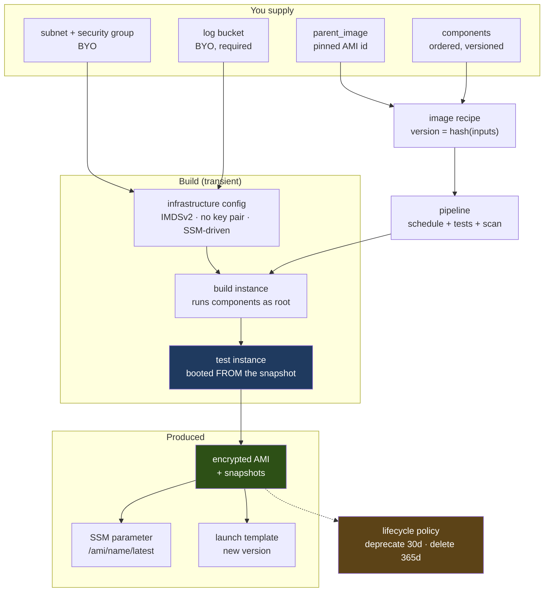

# AMI pipelines on EC2 Image Builder

Governed, reproducible machine images. One module call gives you a recipe, a
build environment, a distribution policy, a schedule, and a retention policy
that actually reclaims snapshot storage.

**Status:** implemented and audited — 19 resources, 4 data sources, 77 variables,
90 validations, 19 preconditions, 12 advisory checks, 21 outputs, 136 plan tests
green, two linters with self-test regressions.

Three independent audits (security, well-architected, correctness) produced
**6 CRITICAL, 10 HIGH and ~30 MEDIUM/LOW** findings. All are fixed, each with a
regression test. See [What the audits found](#what-the-audits-found).

**Still not validated against a live AWS account:** no image has been built by
this module. Several of the criticals were things only a real build would
surface, so read [that section](#read-this-before-trusting-a-green-run) before
trusting a green run.



The **test instance** in that diagram is not decoration. Image Builder runs
`build` and `validate` phases on the build instance, then launches a *second*
instance from the finished snapshot and runs `test` phases there. Two bundled
assertions used to fail every single build because they were in the wrong phase.

---

## Why this module exists

Three problems, in the order they bite.

**1. In an isolated VPC, some things cannot be installed at boot.** The sibling
[`gitlab-runner`](../gitlab-runner/) module's manager bootstrap fetches from
`packages.gitlab.com` and runs `gitlab-runner fleeting install`, which pulls from
GitLab.com. With no internet route both **hang** rather than failing cleanly.
That module's [COSTS.md](../gitlab-runner/COSTS.md) records a baked manager AMI
as prerequisite **P1** — mandatory, not an optimization. This module builds it,
and ships an `install-gitlab-runner` component that does exactly that.

**2. Image Builder versions are immutable, and nothing warns you.** Edit a
component document without bumping its version and the API rejects it. Every
team hits this once, then starts hand-bumping version numbers in three places.
`auto_version = true` (the default) derives versions from a content hash, so
edits always produce a new version and unchanged content is a genuine no-op.

**3. Nothing deletes old AMIs.** A monthly pipeline over three years is 36
images, each holding a full root snapshot, billed per GB-month indefinitely.
Snapshot storage is the only cost line here that grows without bound — over five
years it is roughly **190× the build compute**.

---

## Quick start

```hcl
module "base_image" {
  source = "../../modules/ami-builder"

  name         = "al2023-ci-base"
  parent_image = "ami-0123456789abcdef0" # pinned, deliberately

  components = [
    { name = "hardening", bundled = "amazon-linux-hardening" },
    { name = "docker", bundled = "install-docker" },
    { name = "verify", bundled = "verify-image" },
  ]

  subnet_id          = "subnet-0123456789abcdef0"
  security_group_ids = ["sg-0123456789abcdef0"]
  log_s3_bucket      = "my-imagebuilder-logs" # required

  ami_ssm_parameter_name = "/ami/al2023-ci-base/latest"

  schedule_expression = "cron(0 3 1 * ? *)"
  schedule_timezone   = "Europe/Dublin"
  # See the schedule trap below - with a pinned parent you need this.
  pipeline_execution_start_condition = "EXPRESSION_MATCH_ONLY"
}
```

Then consume it without Terraform in the path:

```hcl
resource "aws_launch_template" "workers" {
  image_id = "resolve:ssm:/ami/al2023-ci-base/latest"
}
```

Two worked examples live in [`examples/`](examples/): a
[general base image](examples/simple/) and the
[GitLab runner manager AMI](examples/gitlab-runner-manager/) that closes the P1
gap above.

### The schedule trap

`pipeline_execution_start_condition` defaults to
`EXPRESSION_MATCH_AND_DEPENDENCY_UPDATES_AVAILABLE`, which builds only when the
base image or a component **version** changes. It cannot see that new *packages*
exist in a repository.

So with a pinned parent (which `allow_unpinned_parent_image = false` forces) and
content-addressed component versions that move only on apply, **nothing ever
changes between applies and the cron never fires**. The pipeline sits `ENABLED`,
reports a monthly cadence, and patches nothing.

The module now refuses to plan that combination —
`check "the_schedule_can_actually_fire"` — and `governance.schedule_can_fire`
reports it separately from `rebuild_schedule`. With a pinned parent, use
`EXPRESSION_MATCH_ONLY`. It costs about $0.04 per build.

---

## Components

One ordered list. Each entry names exactly **one** source:

| Field | Meaning |
|---|---|
| `bundled` | One of this module's shipped components, versioned with the module |
| `document` | Inline AWSTOE YAML, e.g. `file("${path.root}/mine.yaml")` |
| `uri` | A document already in S3 |
| `arn` | An existing component, including AWS-managed ones |

AWSTOE runs every component's **build** phase in list order, then every
**validate** phase, then every **test** phase. Build and validate run on the
build instance; test runs on a fresh instance booted from the snapshot.

### Shipped components

| Name | Does | Asserts |
|---|---|---|
| `amazon-linux-hardening` | Security updates, sshd drop-in, sysctl, journal cap, strips host keys and build artefacts | *validate:* no baked host keys, no `authorized_keys`. *test:* `sshd -T` effective config, password auth actually disabled, sysctl parses, `ip_forward` not disabled |
| `install-docker` | Docker from AL2023 repos, log rotation, `no-new-privileges`, `icc=false` | Daemon actually starts and responds, config is valid JSON *and applied*, enabled on boot, no registry credentials baked in |
| `install-gitlab-runner` | Pinned `gitlab-runner` + `fleeting-plugin-aws`; the repo-script digest is **mandatory** and the step fails closed without it | Version matches what was requested, plugin binary present *and executable*, no `glrt-` token anywhere including `/var`, unit not enabled |
| `verify-image` | Nothing in build (assertions only) | *validate:* cloud-init state and AWSTOE state cleared. *test:* root headroom, SSM agent present, no AWS key material, no world-writable system files, no empty-password accounts |

These are not certification benchmarks. Where you need an attestable one, pass
the AWS-managed `stig-build-linux-high` component by `arn` instead.

`RepoScriptSha256` used to default to empty and merely warn, so the default path
ran a fetched script as root unverified while this table advertised digest
verification as a fact. It now fails closed, matching `RunnerVersion`, which
always did — and both are required at **plan** time, because `bundled` is a
closed set of documents the module can read.

The `amazon-linux-hardening` component deliberately **does not** disable
`net.ipv4.ip_forward` — Docker needs it, and a hardening component that silently
breaks container networking is worse than none. There is a test locking that in.

### Parameter values are validated

`components[*].parameters` values are restricted to
`[A-Za-z0-9 ._:/=,+@-]`. AWSTOE substitutes `{{ Param }}` into the **document
text** before bash sees it, so a heredoc's quoting protects nothing against a
parameter: a newline can terminate a heredoc early and run the following lines
as root.

This matters because parameter values are a lower-trust channel than the
component list itself. Both shipped examples wire them to root-module variables,
so a CI variable whose job is to bump a version number would otherwise be root
code execution in the golden-image pipeline every instance in the estate boots
from.

---

## Prerequisites in an isolated estate

The module creates **no network resources**. `terraform output network_contract`
states what it needs as data; hand it to whoever owns the VPC.

Interface endpoints: `ssm`, `ssmmessages`, `ec2messages`. Plus `kms` only when
`components_call_kms = true`, and `inspector2` only with scanning on. Plus the
**free S3 gateway endpoint**, which is not optional — AWSTOE fetches component
documents from S3 and the AL2023 `dnf` repositories are S3-backed.

EBS snapshot encryption and SSM parameter decryption both happen service-side,
so neither needs a KMS endpoint. The contract used to list `kms` unconditionally
while a note in the same output said it was not needed — $8/AZ/month ordered on
the module's own authority.

**There is no `imagebuilder` endpoint on the list on purpose.** The build
instance talks to SSM, not to the Image Builder control plane. There is a test
asserting the contract never starts recommending it.

**One AZ is enough.** `subnet_id` is a single subnet, so the build instance only
ever lands in one AZ and only needs endpoints there. In a dedicated build VPC
that is the difference between about $24/month and $72/month. The trade is that
an AZ impairment stops builds, which for a retryable pipeline is usually the
right trade — but nothing in the endpoint list used to say so.

**A missing endpoint fails as a hang, not an error.** With no internet route the
instance resolves the public API name, gets no route, and waits until the build
times out. Nothing names the missing piece. `output.verify_commands` now carries
the three commands for that case: find the live build instance by its
`ImageBuilderFor` tag, open a Session Manager shell on it, and cancel the build.

**Two subnets, not one.** A component that installs software from the internet
needs a build subnet with egress. That is not the subnet your fleet runs in. The
whole point is that the fetch happens once at build time in a place that has
connectivity, so instances launched from the image do not need it.

### Key policies are your job too

`terraform output kms_key_policy_requirements` emits, as data, every key-policy
statement your CMKs need and what breaks without it. The module can grant IAM
permissions; it cannot write a key policy.

The one worth knowing: a CMK whose policy omits the CloudWatch Logs grant lets
`CreateLogGroup` succeed and then makes every `PutLogEvents` fail. You get a log
group that exists and stays permanently empty, with no error anywhere.

Note also that `log_s3_kms_key_arn` is a **separate input** from `kms_key_arn`.
`s3:PutObject` into an SSE-KMS bucket needs `GenerateDataKey` on *the bucket's*
key; granting it on the EBS key does nothing and log delivery 403s silently.

---

## Versioning

Default is content-addressed:

```
component version = <version_major>.<hash slice>.<hash slice>
recipe version    = <version_major>.<hash slice>.<hash slice>
```

Recipe versions hash the **inputs** — parent image, component identity, content,
parameters, volume settings, descriptions — not the component ARNs those inputs
produce. ARNs are computed, and an unknown in an immutable version field makes
every plan propose a replacement it cannot justify.

**Every ForceNew attribute a resource sets must be in that resource's hash
input.** `description` and `kms_key_id` were originally left out, so adding a CMK
would have replaced the component *without moving its version* and
`CreateComponent` would fail on a version whose content had not changed —
unrecoverable on retry. There are now three regressions asserting the version
moves.

Two 4-hex slices give about 1,000,000 values. A collision surfaces as an
explicit "version exists with different content" error on apply, never as a
silently wrong image.

**Versions are not human-orderable.** `1.847.221` may be newer than
`1.093.556`; the hash space is not monotonic. That is harmless here because the
recipe pins exact component ARNs, but it means the console's version list is not
chronological — use `verify_commands.list_builds`, which sorts by `dateCreated`.
Anything resolving a `.../x.x.x/N` component reference gets the
numerically-highest version, not the newest.

`auto_version = false` hands you `component_version` and `recipe_version` to
bump by hand. Human-orderable, at the cost of the papercut being reachable
again. Note `component_version` doubles as the workflow version.

`retain_component_versions` defaults to **true**. An AMI in production was built
from a specific component version, and deleting that version destroys the record
of what went into it. Components cost nothing to keep.

**Two consequences of that default, both real:** `terraform destroy` leaves the
component versions behind, and re-applying unchanged content afterwards
regenerates the same content hash and therefore the same name+version — which
`CreateComponent` rejects. For an ephemeral create/validate/destroy CI loop, set
`retain_component_versions = false`.

---

## Retention

| Action | Default | Why |
|---|---|---|
| `DEPRECATE` after 30 days | **on** | Reversible, and only affects discovery. Includes `include_resources { amis = true }`, without which only the Image Builder resource is deprecated and `describe-images` keeps returning the AMI |
| `DELETE` after 365 days | **on** | Snapshot storage is the only cost line that grows without bound, and a policy that deletes nothing costs nothing and saves nothing. Set `lifecycle_delete_after_days = 0` to disable |

Deletion was originally off, on the reasoning that it is irreversible. An audit
pointed out the consequence: the module created a policy, reported it enabled,
satisfied a check named `snapshots_do_not_accumulate_forever`, and let snapshots
accumulate forever. The answer is a *long* horizon behind real exemptions, not
zero.

The module refuses to plan deletion unless at least one exemption is set —
`lifecycle_exclude_recently_launched_days` (default 30) or
`lifecycle_exclude_tags`. Age is a poor proxy for "in use": a six-month-old
image something launched yesterday is load-bearing, and deleting it breaks the
next scale-out rather than the next audit.

Three subtleties, all of which were originally wrong:

- **The selector tag has to be on the Image Builder resource.** AWS evaluates
  `resourceSelection.tagMap` against the Image Builder *image* resource and
  explicitly does not read the output AMI's EC2 tags. `SourceRecipe` therefore
  lives in `common_tags`, not only in `ami_tags`.
- **`is_public = true` EXCLUDES public AMIs** from the action. Setting it false
  left a public AMI eligible for deletion — the inverse of the intent.
- **AMIs shared with other accounts are exempt** via `shared_accounts`, because
  a consumer's launch does not update the owner's last-launched metadata, so
  recency alone cannot protect them.

---

## What costs money

| Line | Driver |
|---|---|
| **VPC interface endpoints** | ~$8/AZ/month each. In a dedicated build VPC this dominates everything: about $24/month at 1 AZ to run $0.04/month of builds. Share a landing zone's endpoints and it is ~$0 marginal |
| **Retained snapshot storage** | ~$0.05/GB-month **per retained image, forever**, until the lifecycle policy removes it. Over five years, roughly 190× the build compute. This is the line that surprises people |
| Build instance | Two instances per build (build + test), ~15–23 minutes total, about **$0.034 per build** |
| Cross-region distribution | A full snapshot copy per region per build, plus transfer. A check warns above three extra regions |
| Fast launch | Windows-only in practice, and `target_resource_count` pre-provisioned snapshots per AMI — a 6× multiplier on the growing line. The module refuses to enable it without a Windows component |
| `root_volume_size_gb` | Not a build cost. It is the default root volume of **every instance launched from the image**: 30 vs 20 GB across 20 workers is about $17.60/month |
| Image Builder itself | $0. The service is free; you pay for what it launches |

The README originally ranked `pipeline_execution_start_condition` above the
lifecycle policy as a cost control. That is backwards by three orders of
magnitude — $14/year versus up to $3,000/year on an aggressive pipeline.

---

## Security posture

`terraform output governance` returns the posture as data, so a reviewer can
diff it and a policy test can assert on it:

```hcl
parent_image_pinned                  = true
parent_image_owner                   = "aws"    # aws | self | third-party
parent_image_verified_at_plan        = true
parent_image_root_device             = "/dev/xvda"
parent_image_architecture            = "x86_64"
components_fetch_from_moving_sources = true     # bundled components run dnf unpinned
snapshots_encrypted_if_root_device_matches_parent = true
customer_managed_key                 = false
imds_v2_required                     = true
build_instance_has_keypair           = false
byo_instance_profile                 = false
permissions_boundary                 = ""
additional_build_policy_arns         = []
lifecycle_deletes_amis               = true
schedule_can_fire                    = true     # NOT the same as "has a schedule"
shared_with_organizations            = []
ami_is_public                        = false
...
```

Several of these field names are the way they are because an earlier version
lied. `snapshots_encrypted = true` was unconditional while the module itself
documents that a wrong `root_device_name` makes AWS discard the mapping and
encryption with it. `schedule_can_fire` exists because `rebuild_schedule`
reported a cron that could never run. `shared_with_organizations` exists because
an AMI shared with an entire AWS Organization used to report as shared with
nobody — and the module's own "nothing shared by default" test passed on it.

Defaults worth knowing:

- **Snapshots are always encrypted.** Not a toggle. `kms_key_arn` chooses
  between your CMK and the AWS-managed key.
- **No key pair.** Image Builder drives the instance over SSM; a key pair is a
  standing SSH credential on a machine holding the build role. Debug with
  `terminate_instance_on_failure = false` and Session Manager instead.
- **IMDSv2 only, hop limit 1**, with checks on both.
- **The build role is the ceiling on what any component can do.** Components run
  as root. `additional_build_policy_arns` is capped at 8 (IAM's quota is 10 and
  the module attaches 2), it is reported in `governance`, and widening it
  without a permissions boundary trips a check.
- **`kms:CreateGrant` is conditioned** on `kms:GrantIsForAWSResource` and
  `kms:ViaService`. Unconditioned, a component could create a persistent grant
  on the estate's image-encryption key for a principal of its choosing,
  surviving the build instance and invisible in a key-policy review.

### Traps the module refuses to let you walk into

**Cross-account distribution without a CMK.** AWS-managed EBS keys cannot be
shared across accounts, so `target_account_ids` with the default key produces an
AMI the target account owns and cannot launch.

**A root device that does not match the parent.** AWS silently discards the whole
block device mapping — volume size and encryption with it — and the build
succeeds. When `parent_image` is a plain AMI id, the module now reads it at plan
time (`verify_parent_image`, default true) and refuses the mismatch.

**An architecture mismatch.** An arm64 parent with x86 `instance_types` fails at
instance launch as a generic Image Builder error. Same guard catches it at plan.

**A `build_timeout` shorter than `image_tests_timeout_minutes`.** Terraform would
abandon an in-flight build and the next apply would start a second one
concurrently against the same recipe.

### Advisory checks

Twelve `check` blocks warn at plan time without refusing: unpinned parent image,
scanning off, key pair set, `terminate_instance_on_failure = false`, tests
disabled, nothing deleting old AMIs, IMDSv1 reachable, a loose IMDS hop limit,
unlogged builds, more than three distribution regions, a schedule that cannot
fire, and a widened build role with no permissions boundary.

`enable_image_scanning` defaults to **false**, and not because it is optional —
turn it on. It defaults off because it requires account-level Inspector EC2
scanning, which this module cannot see or create (the provider has no
`aws_inspector2_*` data source), and setting it true without that prerequisite
**fails the build**. `verify_commands.is_inspector_enabled` gives you the one CLI
call that closes the loop.

---

## Testing

| Layer | What it proves | Run |
|---|---|---|
| 136 plan tests | Graph shape, versions, IAM policy content, every validation and precondition, the governance output, and a regression for each audit finding | `terraform test` |
| `lint_components.py` | AWSTOE schema, undeclared/unused parameters, `curl \| bash`, TLS off, baked credentials, `chmod 777`, multi-line blocks with no `set -e`, plus a cross-check of parameters passed from Terraform | `python3 tests/lint_components.py components --tf-dir examples` |
| `lint_validations.py` | No validation puts a throwing expression in a *later* operand of `\|\|` or `&&` | `python3 tests/lint_validations.py .` |
| Component test phases | That an image actually works | Real build |

Both linters have a `--self-test` mode that reintroduces each defect and
confirms detection, plus asserts the shipped files are clean:

```
$ python3 tests/lint_components.py --self-test
SELF-TEST OK: 7 defects detected, shipped components clean

$ python3 tests/lint_validations.py --self-test
SELF-TEST OK: 10 defects detected, 6 safe forms accepted, module clean
```

### Read this before trusting a green run

**`mock_provider` cannot report `RequiresReplace`.** A changed component
document plans under mocks as *"will be updated in-place"*. Against the real
provider the same change is *"must be replaced — `data`, `description`,
`kms_key_id`, `version` force replacement"*.

So the module's headline feature — immutable-version handling — is invisible to
the plan suite **by construction**. That is exactly how a critical defect
shipped past 78 green tests. The hash-coverage regressions are the closest a
mocked suite can get: they assert the version **moves** when a ForceNew input
changes. That is a proxy, not the property itself.

**The validation linter is precise about which operand matters.** Only a *later*
operand of `||`/`&&` is affected by the 1.9 eager-evaluation difference — if the
*first* operand throws, it throws on every version, which is a different bug. An
earlier version scanned the whole condition and fired on `x[0] == 1 && x[0] == 2`,
which is not a version-specific hazard. It now splits on top-level operators and
only flags a throwing later operand behind a genuine guard. Verified against
eight sibling modules with no false positives.

---

## What the audits found

Three independent audits, read-only, no shared context. They found different
things, which is what independence was for. The five worth knowing as a reader:

**The lifecycle policy selected nothing.** It matched on a `SourceRecipe` tag
that existed only in `ami_tags` — an EC2 AMI tag, which AWS explicitly does not
read for `resourceSelection.tagMap`. The policy applied, the console showed
`ENABLED`, `governance` reported it enabled, a test named for exactly this
invariant passed, and snapshots grew without bound. It never errored.

**The schedule could never fire.** Two defaults were mutually contradictory —
see [the schedule trap](#the-schedule-trap). A patching baseline that patched
once.

**Two bundled test assertions failed every build.** Test components run on a
*new* instance booted from the snapshot, where cloud-init has already
regenerated SSH host keys and `/var/lib/cloud/instance`. There is an internal
proof they could never work there: the same phase runs `sshd -t`, which
*requires* host keys — mutually unsatisfiable on one instance. Both moved to
`validate`.

**The content hash omitted two ForceNew attributes**, which would have produced
an unrecoverable version collision on the first CMK or description change.

**A shipped component deleted the build's own working directory.**
`amazon-linux-hardening` ran `rm -rf /tmp/*` in its build phase with
`working_directory` defaulting to `/tmp`, second of four components in both
examples.

The auditors also verified as sound: no input path to an unencrypted recipe
mapping, no route to a public AMI without the gate, correct confused-deputy
conditions on the lifecycle role, exhaustively clean `create = false` across
every output, correct unknown-value handling (no `for_each` over a computed
ARN), a deterministic and stable hash scheme, and full provider-schema
conformance.

---

## Limits worth knowing before you rely on this

- **Nothing here has built an image.** Every runtime claim comes from the
  provider schema, the AWS docs and the component documents — not from
  observation. The audits' unanimous verdict: one live build in a sandbox is
  worth more than further static review. Apply, trigger a build, edit a bundled
  component, apply again. That sequence exercises the replacement path, the
  lifecycle selector and the notification path at once.
- **`terraform destroy` then re-apply may fail** — see
  [Versioning](#versioning).
- **The recipe has no `skip_destroy`** — confirmed absent from the provider
  schema. Images the *pipeline* produced are invisible to Terraform and may
  block `DeleteImageRecipe` when a component edit replaces the recipe. If that
  happens, `aws imagebuilder delete-image` the old build versions.
- **`build_on_apply` still orphans AMIs.** `create_before_destroy` is now set,
  which fixes the ordering, but `DeleteImage` does not delete the AMI it
  created — so `terraform destroy` leaves the AMI and its snapshots behind.
- **The module creates no SNS topic policy.** `events.amazonaws.com` cannot
  publish to a BYO topic without one, so `create_event_rule = true` yields a
  rule that never delivers until you add it. Named in
  `kms_key_policy_requirements`.
- **Custom workflows are untested beyond plan**, and `workflow` is a *set* on
  `aws_imagebuilder_image`, so order is not preserved on the `build_on_apply`
  path.
- **Container recipes are out of scope.** AMIs only.
- **Windows is nominally supported and unexercised.** Every bundled component is
  Linux.
- **`uri` components hash their URI, not the object behind it.**
- **`instance_types` order is not a priority.** The underlying API field is a
  set, so Terraform discards list order before the request is sent.
- **The provider floor (5.70.0) is a guess on the safe side**, not a bisected
  minimum.

---

## Inputs

Seventy-seven variables. The ones that matter most:

| Name | Type | Default | Notes |
|---|---|---|---|
| `name` | string | — | Prefixes everything; also the log group suffix |
| `parent_image` | string | — | AMI id, Image Builder ARN, or SSM path |
| `allow_unpinned_parent_image` | bool | `false` | Required for an SSM path or any `x` in the ARN version |
| `verify_parent_image` | bool | `true` | Reads the parent at plan time to catch arch and root-device mismatches |
| `components` | list(object) | — | Ordered; exactly one source per entry; parameter values validated |
| `subnet_id` | string | — | Build subnet, single AZ |
| `security_group_ids` | list(string) | — | Egress only |
| `instance_types` | list(string) | `["m6i.large","m6a.large","m5.large"]` | Must match the parent's architecture |
| `kms_key_arn` | string | `""` | CMK for this region's snapshots |
| `log_s3_kms_key_arn` | string | `""` | Separate key: the log **bucket's** SSE-KMS key |
| `distribution_kms_key_arns` | map(string) | `{}` | Region → key; keys validated as regions |
| `log_s3_bucket` | string | **required** | BYO. Required — a build whose output goes nowhere cannot be operated |
| `create_log_group` | bool | `true` | False when the group already exists |
| `components_call_kms` | bool | `false` | Adds the kms endpoint to the contract |
| `ami_ssm_parameter_name` | string | `""` | The intended consumption path |
| `schedule_expression` | string | `""` | 6-field AWS cron; 5 fields is rejected |
| `pipeline_execution_start_condition` | string | `..._AND_DEPENDENCY_UPDATES_AVAILABLE` | With a pinned parent you want `EXPRESSION_MATCH_ONLY` |
| `image_tests_timeout_minutes` | number | `120` | Must not exceed `build_timeout` |
| `build_timeout` | string | `"180m"` | Only used with `build_on_apply` |
| `auto_version` | bool | `true` | Content-addressed versions |
| `enable_image_scanning` | bool | `false` | Needs account-level Inspector; turn it on |
| `lifecycle_delete_after_days` | number | `365` | 0 disables deletion entirely |
| `target_account_ids` | list(string) | `[]` | Requires a CMK |
| `build_on_apply` | bool | `false` | Blocks apply for the build |

Run `terraform-docs markdown .` for the full set.

## Outputs

| Name | Use |
|---|---|
| `pipeline_arn` | `aws imagebuilder start-image-pipeline-execution --image-pipeline-arn <this>` |
| `ami_launch_template_reference` | Paste into a launch template's `image_id` |
| `ami_ssm_parameter_name` | What consumers should read |
| `ami_id` / `ami_ids_by_region` | Only with `build_on_apply` |
| `component_versions` | Exact versions baked in — capture in the change record |
| `governance` | The posture, as data |
| `network_contract` | Hand to whoever owns the VPC |
| `kms_key_policy_requirements` | Hand to whoever owns KMS |
| `verify_commands` | Copy-paste checks, including the three for a hung build |
| `build_instance_role_name` | Attach component-specific permissions here |

## Not in scope

| Out | Why |
|---|---|
| VPC, subnets, endpoints, security groups | BYO, like the sibling runner modules |
| S3 log bucket | In a regulated estate its policy, key, retention and replication belong to whoever owns S3 |
| KMS keys, key policies, SNS topics and topic policies | BYO. Both contracts are emitted as outputs |
| Container images | `aws_imagebuilder_container_recipe` is deliberately unused |
| Account-level Inspector enablement | Cannot be created per-pipeline |
| The launch templates it updates | It rewrites the AMI in yours; it does not create them |
