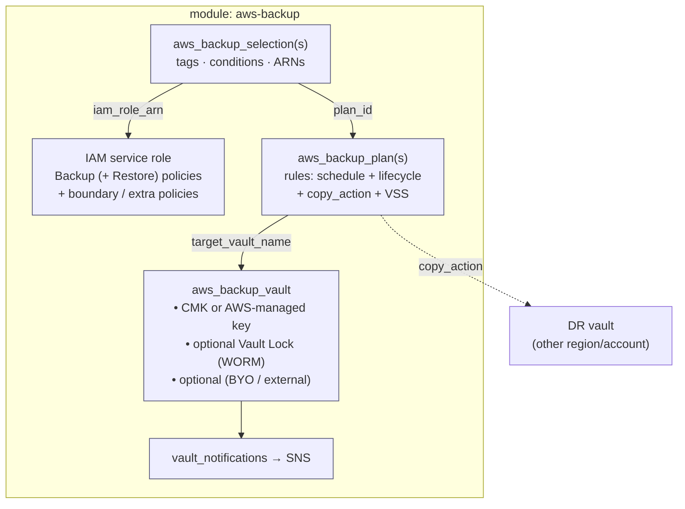

# aws-backup

**Centralized, policy-driven AWS Backup — an (optional) encrypted, WORM-lockable
vault, schedule-driven plans with lifecycle tiering and cross-region / cross-account
copy, and tag- or condition-based resource selection.**

Point the plans at their own vault or a central one, bring your own IAM role or
let the module build one, and lock everything down with CMK encryption, a
permissions boundary, and Vault Lock. Failure notifications are opt-in — wire an
SNS topic so failed jobs aren't silent.

---

## Contents

- [Architecture](#architecture)
- [Quick start](#quick-start)
- [Recipes](#recipes)
- [Requirements](#requirements)
- [Inputs](#inputs) · [Outputs](#outputs)
- [Testing](#testing)
- [Limitations & gotchas](#limitations--gotchas)

---

## Architecture



## Quick start

> Runnable minimal example: [`examples/simple`](examples/simple/main.tf).

```hcl
module "backups" {
  source     = "path/to/modules/aws-backup"
  vault_name = "app-backup"

  plans = {
    daily = {
      rules = {
        daily = {
          schedule          = "cron(0 5 * * ? *)"  # 05:00 UTC
          delete_after_days = 35
        }
      }
      selections = {
        tagged = { selection_tags = [{ key = "Backup", value = "true" }] }  # tag resources Backup=true
      }
    }
  }
}
```

The vault, the IAM role (with the AWS-managed Backup + Restore policies), and the
selection are all created for you.

## Recipes

**Immutable / compliance retention (Vault Lock).** WORM-protect recovery points.
In compliance mode the lock is *irreversible* once the grace period elapses:

```hcl
vault_lock = {
  enabled             = true
  min_retention_days  = 30
  changeable_for_days = 3   # 0 = governance (admin-removable); >= 3 = compliance (permanent)
}
```

**Central vault, many plan modules.** Let a landing-zone stack own the vault and
have workload stacks target it — the stateful vault is never at rename risk:

```hcl
create_vault = false
vault_name   = "org-central-vault"   # existing vault the plans write to
```

**Cross-region DR copy.** Copy each recovery point to a vault elsewhere (region or
account) with its own lifecycle:

```hcl
copy_actions = [{
  destination_vault_arn = "arn:aws:backup:us-west-2:1122...:backup-vault:dr"
  delete_after_days     = 120
}]
```

**Cold-storage tiering.** Tier to cold, then expire (AWS wants
`delete_after >= cold_storage_after + 90`):

```hcl
cold_storage_after_days = 30
delete_after_days       = 365
opt_in_to_archive       = true   # for resource types that need the archive opt-in
```

**Point-in-time restore (continuous backup).** 1–35 day PITR window — no cold
storage and no copies alongside it:

```hcl
enable_continuous_backup = true
delete_after_days        = 35
```

**Richer selection (patterns / exclusions).** Beyond simple `selection_tags`
equality, use `conditions` for glob and negation, and stack multiple selections
on one plan:

```hcl
selections = {
  prod = {
    conditions = [
      { test = "StringLike",       key = "aws:ResourceTag/Environment", value = "prod*" },
      { test = "StringNotEquals",  key = "aws:ResourceTag/Backup",      value = "false" },
    ]
  }
  explicit = { resources = ["arn:aws:dynamodb:us-east-1:1122...:table/orders"] }
}
```

**Guardrailed IAM.** Attach a boundary and scoped customer-managed policies, or
drop restore rights entirely:

```hcl
role_permissions_boundary_arn = "arn:aws:iam::1122...:policy/boundary"
additional_policy_arns        = ["arn:aws:iam::1122...:policy/scoped-backup"]
attach_restore_policy         = false   # backup-only role
```

## Requirements

| Requirement | Detail |
|---|---|
| Terraform | `>= 1.9.0` (tested on 1.9.8 and current) |
| AWS provider | `>= 5.40.0, < 6.0.0` |

## Inputs

| Name | Description | Type | Default |
|---|---|---|---|
| `create` | Master switch. | `bool` | `true` |
| `create_vault` | Create the vault (false = target an existing `vault_name`). | `bool` | `true` |
| `vault_name` | Vault to create, or the existing one to target. | `string` | `"default-backup"` |
| `kms_key_arn` | CMK for recovery points (empty = AWS-managed key). | `string` | `""` |
| `force_destroy` | Allow destroying a non-empty vault. | `bool` | `false` |
| `vault_lock` | WORM lock `{enabled, min_retention_days, max_retention_days, changeable_for_days}`. | `object` | `{}` (off) |
| `vault_access_policy_json` | Vault resource policy (e.g. cross-account copy destination). | `string` | `""` |
| `create_role` | Create the Backup IAM service role. | `bool` | `true` |
| `role_arn` | Existing role ARN (when `create_role=false`). | `string` | `""` |
| `role_name` | Name for the created role. | `string` | `"aws-backup-role"` |
| `attach_restore_policy` | Attach the Restore policy (false = backup-only role). | `bool` | `true` |
| `additional_policy_arns` | Extra policy ARNs for the created role. | `list(string)` | `[]` |
| `role_permissions_boundary_arn` | Permissions boundary for the created role. | `string` | `""` |
| `notifications_sns_topic_arn` | SNS topic for vault events (empty = off). | `string` | `""` |
| `notification_events` | Vault events to publish (validated against the AWS enum). | `list(string)` | `[BACKUP/COPY/RESTORE_JOB_FAILED]` |
| `plans` | Backup plans; shape below. | `map(object)` | `{}` |
| `tags` | Tags. | `map(string)` | `{}` |

```hcl
plans = {
  <plan_name> = {
    rules = {
      <rule_name> = {
        schedule                     = string          # cron(...) / rate(...)
        schedule_expression_timezone = optional(string, "Etc/UTC")
        start_window_minutes         = optional(number, 60)    # AWS min 60
        completion_window_minutes    = optional(number, 180)
        cold_storage_after_days      = optional(number, 0)     # 0 = no tiering
        delete_after_days            = optional(number, 0)     # 0 = never expire
        opt_in_to_archive            = optional(bool, false)
        enable_continuous_backup     = optional(bool, false)   # PITR; no cold/copy
        recovery_point_tags          = optional(map(string), {})
        copy_actions = optional(list(object({
          destination_vault_arn   = string
          cold_storage_after_days = optional(number, 0)
          delete_after_days       = optional(number, 0)
        })), [])
      }
    }
    selections = optional(map(object({          # one or more, keyed by name
      resources      = optional(list(string), [])   # ARNs or ["*"]
      not_resources  = optional(list(string), [])
      selection_tags = optional(list(object({        # simple equality (AND)
        type  = optional(string, "STRINGEQUALS")
        key   = string
        value = string
      })), [])
      conditions = optional(list(object({            # StringEquals/Like/NotEquals/NotLike
        test  = string
        key   = string                               # e.g. "aws:ResourceTag/Env"
        value = string
      })), [])
    })), {})
    advanced_backup_settings = optional(list(object({  # e.g. Windows VSS
      resource_type  = string
      backup_options = map(string)
    })), [])
  }
}
```

> All variables are `nullable = false`; validations are null-safe on TF 1.9+ and
> encode the real AWS lifecycle rules (cold+90, PITR 1–35, start window ≥ 60, …).

## Outputs

| Name | Description |
|---|---|
| `vault_arn` / `vault_name` | The vault (arn is null when `create_vault=false`). |
| `vault_locked` | Whether Vault Lock is configured. |
| `role_arn` / `role_name` | IAM role AWS Backup assumes (name is null for BYO roles). |
| `plan_ids` / `plan_arns` | Map of plan name → ID / ARN. |
| `selection_ids` | Map of `"plan/selection"` → selection ID. |

## Testing

`terraform test` runs 42 mocked plan/apply checks. Coverage includes: default
vault + role (both managed policies, partition-aware) + plan + selection; multiple
rules, plans, and selections per plan; window/lifecycle/archive rendering;
`recovery_point_tags` merge; CMK + governance- and compliance-mode Vault Lock;
custom + validated notification events; continuous backup; multiple cross-region
copies; `condition`-based selection; Windows VSS; schedule timezone; external
(BYO) vault; BYO role wiring; IAM boundary + extra policies + restore opt-out; and
a full validation-failure set (empty/null rules, empty selection, cold+90,
continuous-with-cold, continuous-with-copy, bad schedule, start-window<60, PITR
range, too many tags, bad condition test, bad event, bad copy ARN, bad lock
grace, lock retention >36500, bad vault name). Green on 1.9.8 and current; a live
sandbox apply is the final gate.

## Limitations & gotchas

- **Compliance-mode Vault Lock is permanent.** Once `changeable_for_days` elapses
  the lock can't be removed, shortened, or the vault deleted before retention —
  by anyone, AWS included. Try governance mode (`changeable_for_days = 0`) first.
- **`force_destroy` won't override a Vault Lock.** Locked recovery points block
  destroy regardless — that's the point of WORM.
- **Failure notifications are opt-in.** Without `notifications_sns_topic_arn`,
  failed jobs are silent. Wire an SNS topic in production.
- **Cross-region/account copy needs the destination vault to exist already** — the
  module wires the `copy_action` but doesn't create the remote vault. On the
  *receiving* account, set `vault_access_policy_json` so the source account's
  Backup service may write copies in.
- **Resource types must be opted in per account/region.** AWS Backup silently
  skips resource types that aren't opted in (`aws_backup_region_settings`, a
  landing-zone concern) — a valid-looking plan can protect nothing until then.
- **Rule retention vs Vault Lock:** if a rule's `delete_after_days` is below
  `vault_lock.min_retention_days`, the lock's minimum wins at runtime — keep them
  consistent.
- **The 50-tag ceiling is shared.** AWS fails a job if the plan's
  `recovery_point_tags` + the source resource's own tags exceed 50 per recovery
  point; the module caps its side at 45, but budget for the source tags too.
- **Renaming a plan or selection key recreates it** (they're `for_each` keys).
  Harmless — plans/selections are stateless config — but expect the replace.
- **Continuous backup (PITR)** excludes cold storage and copies, and only a subset
  of services support it (S3, RDS/Aurora, DynamoDB, SAP HANA) — AWS enforces the
  list at runtime.
- **Out of scope:** restore-testing plans, Backup audit framework/reports, and
  account/region resource-type opt-in (all better owned elsewhere).
```
