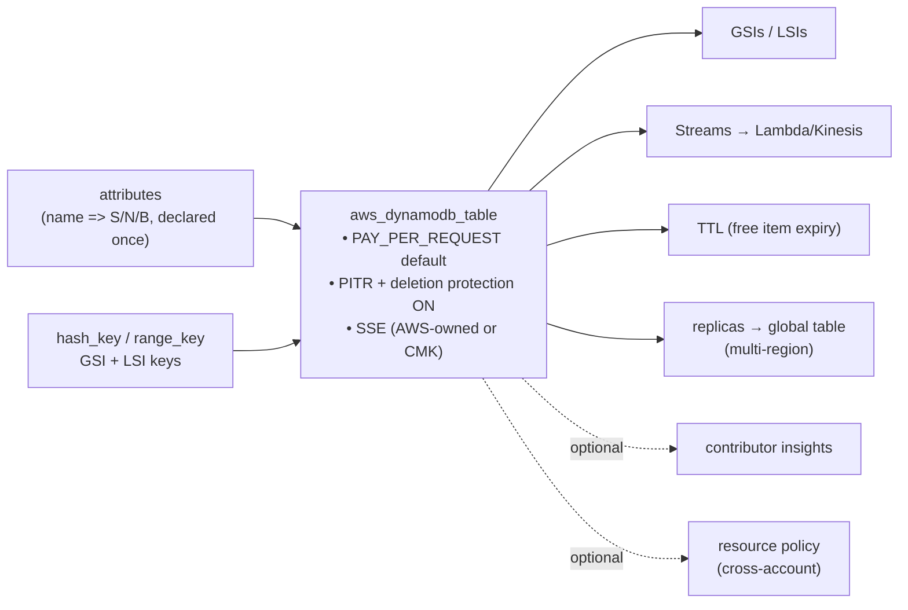

# dynamodb

**A secure-by-default DynamoDB table — PITR, deletion protection, and encryption
on out of the box — where you declare each key type once and the module renders
the rest.**

Built for AWS-experienced engineers: on-demand by default (no capacity
planning), first-class GSIs/LSIs/streams/TTL/global-tables, optional CMK and
resource policy, and plan-time preconditions that catch key/capacity mistakes
before AWS does.

---

## Contents

- [Architecture](#architecture)
- [Quick start](#quick-start)
- [Recipes](#recipes)
- [Requirements](#requirements)
- [Inputs](#inputs) · [Outputs](#outputs)
- [Testing](#testing)
- [Limitations](#limitations)

---

## Architecture



The DX win: **key attribute types live in `attributes` once**; `hash_key`,
`range_key`, and every index key reference those names, and a precondition
proves each key resolves. No repeating types, no opaque provider errors.

## Quick start

> Runnable minimal example: [`examples/simple`](examples/simple/main.tf).

```hcl
module "table" {
  source = "path/to/modules/dynamodb"

  name       = "sessions"
  hash_key   = "pk"
  attributes = { pk = "S" }
  # PAY_PER_REQUEST, PITR on, deletion protection on, encrypted — all default
}
```

## Recipes

### Single-table design (composite key + GSIs + TTL + stream)

```hcl
hash_key  = "pk"
range_key = "sk"
attributes = { pk = "S", sk = "S", gsi1pk = "S", gsi1sk = "S" }

global_secondary_indexes = {
  GSI1 = { hash_key = "gsi1pk", range_key = "gsi1sk", projection_type = "ALL" }
}
stream_enabled = true          # NEW_AND_OLD_IMAGES by default
ttl_attribute  = "expires_at"  # DynamoDB deletes expired items for free
```

### Global table (multi-region active-active)

```hcl
stream_enabled = true          # required for replicas
replicas = [
  { region_name = "eu-west-1" },
  { region_name = "ap-southeast-2" },
]
```

### Provisioned capacity

```hcl
billing_mode   = "PROVISIONED"
read_capacity  = 25
write_capacity = 25
global_secondary_indexes = {
  GSI1 = { hash_key = "gsi1pk", read_capacity = 10, write_capacity = 10 }
}
```

### On-demand spend caps (FinOps guardrail)

```hcl
# PAY_PER_REQUEST: bound the worst case so a runaway scan can't blow the bill
max_read_request_units  = 4000
max_write_request_units = 2000
global_secondary_indexes = {
  GSI1 = { hash_key = "gsi1pk", max_read_request_units = 1000 }
}
```

### Customer-managed key + cross-account resource policy

```hcl
kms_key_arn          = aws_kms_key.data.arn
resource_policy_json = data.aws_iam_policy_document.table_access.json
```

### Terraform state lock table

```hcl
name = "terraform-locks", hash_key = "LockID", attributes = { LockID = "S" }
# PITR + deletion protection default-on — exactly right for locks
```

## Requirements

| Requirement | Detail |
|---|---|
| Terraform | `>= 1.9.0` (tested on 1.9.8 and current) |
| AWS provider | `>= 5.40.0, < 6.0.0` |

## Inputs

| Name | Description | Type | Default |
|---|---|---|---|
| `create` | Master switch. | `bool` | `true` |
| `name` | Table name. | `string` | — |
| `hash_key` | Partition key (must be in `attributes`). | `string` | — |
| `range_key` | Sort key (in `attributes`), or "". | `string` | `""` |
| `attributes` | Key attribute types: name => S\|N\|B. | `map(string)` | — |
| `billing_mode` | `PAY_PER_REQUEST` or `PROVISIONED`. | `string` | `"PAY_PER_REQUEST"` |
| `read_capacity` / `write_capacity` | Base capacity (PROVISIONED only, > 0). | `number` | `0` |
| `max_read_request_units` / `max_write_request_units` | On-demand spend caps for the table (PAY_PER_REQUEST only; 0 = uncapped). | `number` | `0` |
| `global_secondary_indexes` | `{hash_key, range_key?, projection_type?, non_key_attributes?, read_capacity?, write_capacity?, max_read_request_units?, max_write_request_units?}`. | `map(object)` | `{}` |
| `local_secondary_indexes` | `{range_key, projection_type?, non_key_attributes?}` (create-time only). | `map(object)` | `{}` |
| `deletion_protection` | Block table deletion. | `bool` | `true` |
| `point_in_time_recovery` | Continuous backups (35-day restore). | `bool` | `true` |
| `kms_key_arn` | CMK for encryption at rest ("" = the free AWS-owned key; always encrypted either way). | `string` | `""` |
| `table_class` | `STANDARD` or `STANDARD_INFREQUENT_ACCESS`. | `string` | `"STANDARD"` |
| `ttl_attribute` | Epoch-seconds expiry attribute ("" = off). | `string` | `""` |
| `stream_enabled` | Enable Streams (CDC). | `bool` | `false` |
| `stream_view_type` | KEYS_ONLY\|NEW_IMAGE\|OLD_IMAGE\|NEW_AND_OLD_IMAGES. | `string` | `"NEW_AND_OLD_IMAGES"` |
| `replicas` | Global-table replicas `{region_name, kms_key_arn?, point_in_time_recovery?, propagate_tags?}`. | `list(object)` | `[]` |
| `contributor_insights` | Enable Contributor Insights. | `bool` | `false` |
| `resource_policy_json` | Resource-based policy JSON ("" = none). | `string` | `""` |
| `tags` | Tags. | `map(string)` | `{}` |

> All variables are `nullable = false`; validations are null-safe on TF 1.9+.

## Outputs

| Name | Description |
|---|---|
| `table_name` / `table_arn` / `table_id` | The table. |
| `index_arn_pattern` | `${table_arn}/index/*` — drop into an IAM policy for GSI/LSI Query access. |
| `gsi_names` / `lsi_names` | Names of the secondary indexes. |
| `stream_arn` / `stream_label` | Stream identifiers (null unless enabled). |
| `replica_regions` | Regions the table is replicated to. |

## Testing

`terraform test` runs 42 mocked plan/apply checks. Rendering: secure defaults
(AWS-owned key, no SSE block), composite key + multiple GSIs/LSIs, provisioned +
GSI capacity, on-demand spend caps, TTL on/off, streams, table class, PITR /
deletion-protection passthrough, tag merge, global-table per-replica settings,
contributor insights, resource-policy wiring, and outputs (incl. the index-ARN
pattern). Failures: undeclared/unused/null attributes, table & GSI
provisioned-without-capacity, on-demand-caps-under-provisioned, replicas-without-
stream, duplicate/too-short/too-many index names, hash==range (table/GSI/LSI),
LSI count > 5, bad types, INCLUDE-without-attributes, bad billing mode. Green on
1.9.8 and current. A live apply in a sandbox is the final gate.

## Limitations

- **Provisioned autoscaling is an explicit non-goal.** Terraform can't make
  `lifecycle { ignore_changes }` conditional, so wiring Application Auto Scaling
  into the module would either flap the plan on every scale event or break
  GitOps for fixed-capacity tables. Prefer `PAY_PER_REQUEST` (with the
  `max_*_request_units` caps above) for most workloads, or attach
  `aws_appautoscaling_target`/`policy` at the call site against the `table_name`
  output and the `gsi_names`. Note: adding replicas to a *provisioned* table
  effectively requires autoscaling on the replicas, so global tables pair best
  with on-demand.
- **LSIs are create-time only** (an AWS constraint) — you can't add/remove one
  after the table exists without replacing it. Max 5 LSIs (hard) — enforced.
- **`attributes` holds KEY attributes only** — DynamoDB is schemaless for
  non-key fields; don't list them. Every attribute must be used by some key
  (table/GSI/LSI) or the module blocks the plan (AWS rejects unused ones).
- **Deletion protection is on by default**, so `terraform destroy` fails until
  you set `deletion_protection = false` and apply first.
- **Replica settings are limited to what the inline `replica` block exposes**
  (`kms_key_arn`, `point_in_time_recovery`, `propagate_tags`). Per-replica
  `table_class` / GSI overrides / deletion-protection aren't offered by the
  provider block, so they aren't here either.
- **Out of scope:** `warm_throughput`, on-demand backups beyond PITR, restoring
  from PITR, and `import_table` from S3 — wire them at the call site if needed.
