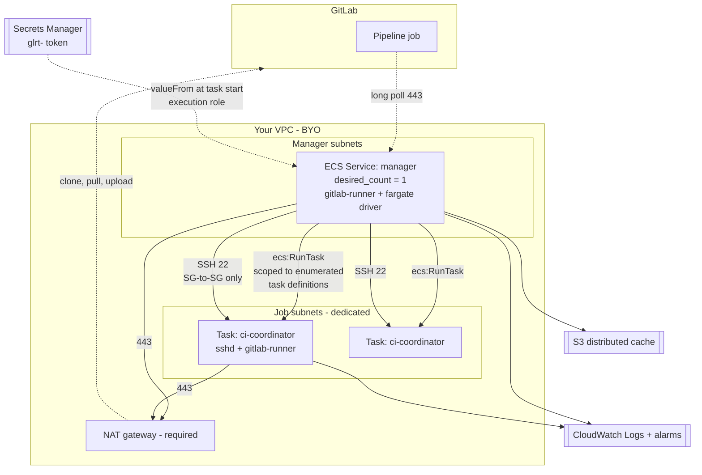

# GitLab CI runners on AWS ECS Fargate

One CI job, one Fargate task. No EC2 instances to patch, no Docker daemon, no
host to escape to. A single long-lived manager task drives the fleet through the
GitLab Runner custom executor and the AWS Fargate driver.

> ## Read this before you adopt it
>
> This platform has three hard limits that are **not** configuration choices.
> They are properties of the Fargate driver and of Fargate itself, and if any of
> them is unacceptable, use the EC2 sibling module
> [`modules/gitlab-runner`](../gitlab-runner) instead — it has none of them.
>
> 1. **`image:` and `services:` in `.gitlab-ci.yml` are IGNORED.** The image comes
>    from the ECS task definition. GitLab's own words: *"The `image` and `service`
>    keywords in your `.gitlab-ci.yml` file are ignored. The runner only uses the
>    values specified in the task definition."* No `services:` means no sidecar
>    Postgres or Redis through GitLab CI — add them as extra containers in the task
>    definition (they share the task network namespace, so `localhost` works) or
>    point at managed services. **This breaks most existing `.gitlab-ci.yml`
>    files.**
> 2. **No Docker-in-Docker.** Fargate forbids privileged containers and exposes no
>    Docker socket. Image builds need Kaniko, rootless BuildKit, or Buildah, baked
>    into your job image. Note `image: gcr.io/kaniko-project/executor` in
>    `.gitlab-ci.yml` will silently do nothing — see limit 1.
> 3. **The custom executor is in maintenance mode and the Fargate driver is
>    community-supported.** GitLab: *"The Fargate custom executor driver is not
>    maintained by GitLab and is supported on a best-effort basis."* There is no
>    fleeting/ECS plugin and none is announced, so this design has no supported
>    successor path. Budget for owning the driver; it is MIT and about 3k lines of
>    Go.
>
> The module is built to be excellent *within* those limits. It cannot remove
> them.

## Why this module exists

It is a deliberate second attempt. The EC2 sibling accumulated 61 findings across
four adversarial audit tracks, and every rule in
[`ENGINEERING.md`](ENGINEERING.md) is derived from a specific one of them. That
document is the specification: **a change that violates a rule there does not get
merged, even if `terraform test` is green** — because in the sibling, 105 green
plan tests coexisted with a fleet that could not launch a single worker.

Several of the sibling's worst defect classes are not defended against here, they
are **structurally impossible**:

| Sibling defect class | Status here |
|---|---|
| Shell injection through a config template | **Impossible.** The module transports no shell. Configs travel base64-encoded in the task definition and the entrypoint ships in your image. |
| Heredoc breakout | **Impossible.** There is no heredoc. |
| `user_data` readable via `ec2:DescribeInstanceAttribute` | **Gone.** No user_data exists. |
| Root on the manager via a raw-TOML escape hatch | **Impossible.** There is no raw-text config input at all (R1.4). Configuration is extended by adding a typed input. |
| Docker socket / privileged mount to worker root | **Impossible.** Fargate has neither. |
| Unpinned AMI drift, bootstrap failure, disk fill, logrotate | **Gone.** No AMI, no bootstrap script, no persistent disk. |
| Orphaned scale-in-protected workers billing forever | **Changed, not gone.** No ASG and no instance protection — but the manager is the only thing that calls `StopTask`, and it is a singleton designed to be replaced. A job task orphaned by manager loss keeps `sshd` alive and **bills until reaped**. See `job_max_lifetime_seconds` and `verify_commands.orphans`. |

## Architecture



Per job: the driver's `prepare` stage calls `ecs:RunTask`, waits for the task,
resolves its private IP, generates a fresh ECDSA keypair and injects the public
half as `SSH_PUBLIC_KEY`; `run` SSHes in once per script stage; `cleanup` calls
`ecs:StopTask`.

## Quick start

```hcl
module "runners" {
  source = "../../modules/gitlab-runner-fargate"

  name       = "ci"
  gitlab_url = "https://gitlab.com"

  # The ONLY way to supply the token. There is no runner_token string input,
  # because that path puts the token in Terraform state.
  runner_token_secret_arn = aws_secretsmanager_secret.runner_token.arn

  vpc_id             = data.aws_vpc.this.id
  manager_subnet_ids = [for s in data.aws_subnet.private : s.id]
  job_subnet_ids     = [for s in data.aws_subnet.ci : s.id] # dedicated, see below

  manager_image = "${aws_ecr_repository.manager.repository_url}@sha256:..."

  job_profiles = {
    default = {
      image  = "${aws_ecr_repository.job.repository_url}@sha256:..."
      cpu    = 1024
      memory = 2048
    }
  }

  cache_bucket_name    = aws_s3_bucket.cache.id
  alarm_sns_topic_arns = [aws_sns_topic.ci.arn]
}
```

You must build two images. See [`docker/`](docker/) for the reference
Dockerfiles and the entrypoint contract.

## Prerequisites in an isolated estate (no internet)

This module creates **no** VPC, subnets, routing, NAT, or endpoints — that belongs
to your landing zone. What it needs to exist first is listed here so you can hand
it to whoever owns the network.

Set `isolated = true` and the module enforces the consequences instead of leaving
them to you. It refuses to plan if any of them is missing.

### 1. VPC endpoints — the list, and why each one

A missing endpoint is a **silent hang**, not an error: the ECS agent falls back to
the public DNS name, finds no route, and waits. Nothing names the missing endpoint.

| Endpoint | Type | Who needs it | What breaks without it |
|---|---|---|---|
| `ecr.api` | Interface | Fargate agent | Image pull fails |
| `ecr.dkr` | Interface | Fargate agent | Image pull fails |
| **`s3`** | **Gateway** | Fargate agent | Image pull fails — ECR stores layers in S3. A gateway endpoint, not interface; it is also free |
| `logs` | Interface | `awslogs` driver | Task fails `ResourceInitializationError`; no logs at all |
| `secretsmanager` | Interface | Execution role | Runner token cannot be resolved → manager will not start |
| **`ecs`** | Interface | **The manager itself** | `ecs:RunTask` unreachable → images pull fine and **zero jobs ever launch** |
| `sts` | Interface | Jobs using OIDC | `AssumeRoleWithWebIdentity` fails |
| `kms` | Interface | Only with a CMK | Secret or cache decryption fails |
| `ssmmessages` | Interface | Only with ECS Exec | ECS Exec hangs |

`output.required_vpc_endpoints` emits this list for your actual configuration, so
you can diff it against what the VPC has.

> **Private DNS must be enabled on every interface endpoint.** Without it the
> endpoint serves only its own `vpce-…` DNS names, nothing redirects the ECS agent
> to them, so the agent resolves the *public* name — and in your VPC there is no
> route to it. The endpoints are billed and carry no traffic. This module refuses
> `isolated = true` unless private DNS is on (or you point it at endpoints you own
> via `existing_endpoint_security_group_ids`).

### 2. Reachability to on-prem

`on_prem_cidrs` gets TCP 443 from **both** tiers — the manager for GitLab's API,
job tasks for `git clone` and artifact upload. Keep it narrow: this is the one
place the module deliberately grants job tasks access to internal address space.

Note the default `job_egress_cidrs` carve-out excludes RFC1918 — correct for an
internet-facing fleet, **wrong for yours**, because your GitLab lives there. With
`isolated = true`, `job_egress_cidrs = []` means exactly "no general egress", and
on-prem plus endpoint reachability is granted separately. That is the tightest
correct posture.

### 3. Two container images, built where you have connectivity

`image:` in `.gitlab-ci.yml` is ignored on this platform, so the job image comes
from the task definition. In an isolated estate that is arguably a **feature**: a
pipeline cannot choose an unvetted image, and `job_profiles` is your approved list.

Both images must be built somewhere with internet access (or from internal
mirrors) and pushed to an ECR the fleet can reach. See [`docker/`](docker/). The
shipped Dockerfiles pull from `deb.debian.org` and GitLab's release CDN, so they
will not build inside the isolated VPC as written — point them at your mirrors.

### 4. A private CA, if GitLab uses one

Set `manager_ca_certificate_pem`. The bundle is written to the manager's writable
config volume and referenced from `config.toml` as `tls-ca-file`. It is **not**
installed into the system trust store — that lives on a read-only filesystem, and
attempting it is what previously crash-looped the manager.

### 5. If GitLab's external URL is not what you can reach

Set `runner_clone_url`. Common when GitLab is published at one name externally and
reachable at another internally, or sits behind a reverse proxy.

### Worked isolated configuration

```hcl
module "runners" {
  source = "../../modules/gitlab-runner-fargate"

  name       = "ci"
  isolated   = true
  gitlab_url = "https://gitlab.corp.internal"

  runner_token_secret_arn    = var.runner_token_secret_arn
  manager_ca_certificate_pem = file("corp-root-ca.pem")

  vpc_id             = var.vpc_id
  manager_subnet_ids = var.manager_subnet_ids
  job_subnet_ids     = var.job_subnet_ids   # dedicated

  # Reach on-prem GitLab and the internal registry over DX/VPN.
  on_prem_cidrs = ["10.10.0.0/16"]

  # No general egress at all. On-prem and endpoints are granted separately.
  job_egress_cidrs     = []
  manager_egress_cidrs = []

  # Endpoints owned by the landing zone. Alternatively create_vpc_endpoints = true
  # with endpoint_private_dns = true.
  existing_endpoint_security_group_ids = [var.vpc_endpoint_sg_id]

  manager_image = "${var.ecr}/gitlab-runner-manager@sha256:..."

  job_profiles = {
    standard = {
      image        = "${var.ecr}/ci-standard@sha256:..."
      cpu          = 1024
      memory       = 2048
      ssh_username = "ci"          # non-root; the image creates this user
    }
  }
  default_job_profile = "standard"

  cache_bucket_name            = aws_s3_bucket.cache.id
  cache_server_side_encryption = "aws:kms"
  cache_kms_key_arn            = aws_kms_key.cache.arn

  alarm_sns_topic_arns = [aws_sns_topic.ci.arn]
}
```

### What still will not work, isolated or not

- **`services:`** — no sidecar Postgres/Redis via GitLab CI. Add them as extra
  containers in the task definition, or point at managed services.
- **DinD** — Fargate forbids privileged containers. Use Kaniko or rootless
  BuildKit, baked into the job image.
- **Orphaned job tasks** — the manager is the only thing that calls `StopTask`.
  A job task orphaned by manager loss bills until reaped. See
  `output.verify_commands.orphans` and `job_max_lifetime_seconds`.

## The two security properties that need your attention

Everything else in this module is ordinary least privilege. These two are not,
because they compensate for defects in the driver itself.

### 1. The driver does not verify the job task's SSH host key

The driver calls `ssh.InsecureIgnoreHostKey()`. Whatever answers on the resolved
private IP:22 receives the manager's session — and that session carries the
generated build script, which contains `CI_JOB_TOKEN` and every job variable.
Pinning the host key is not possible with the upstream driver: it has no
out-of-band channel to learn a key generated seconds before the connection. (Note
the reference image generates a *fresh* key per task, so keys are not shared
across tasks — an earlier version of this document said otherwise.)

**What contains it:** the job security group's only inbound rule is TCP 22
**referencing the manager's security group** — never a CIDR. GitLab's own
documentation suggests "source: the VPC CIDR" for that rule; that is wrong, and
this module will not do it. Give job tasks dedicated subnets that hold nothing
else. A test asserts `cidr_ipv4 == null` on that rule so it cannot regress.

### 2. CI variables can retarget the driver

The driver reads `CUSTOM_ENV_FARGATE_TASK_DEFINITION`, `_SUBNET`,
`_SECURITY_GROUP` and `CUSTOM_ENV_ROLE_ARN`, and GitLab Runner exposes every
CI/CD variable to the stage executables with a `CUSTOM_ENV_` prefix. So **anyone
who can set a CI/CD variable on a project using this runner can make the manager
launch a different task definition** — including one with a more privileged task
role.

**What contains it:** `ecs:RunTask` is scoped to the enumerated task-definition
ARNs of `job_profiles` and nothing else, and `iam:PassRole` is scoped to exactly
the roles those profiles use. Those two lists are the entire boundary. So:

- Never add a profile whose `task_role_arn` you would not hand to any pipeline
  that can reach this runner.
- Leave `task_role_arn` empty (the default) and use **GitLab ID tokens with
  `sts:AssumeRoleWithWebIdentity`** for per-project AWS access — see
  [`modules/ci-oidc`](../ci-oidc). One shared task role is one blast radius for
  every project on the fleet.
- If you need real per-project isolation, run separate fleets, not separate
  profiles on one fleet.

Review `output.manager_policy_statements` in a plan diff. It is the real
authorization model, not a summary.

## The job-pickup gap

Stated because it is real, not buried because it is inconvenient.

The alarms below prove there **is** a manager and that the fleet is not pinned at
its ceiling. They do **not** prove jobs are being picked up. A revoked or rotated
token, a GitLab-side 401, or an API throttle leaves the manager task running and
serving `/metrics`, so `manager-absent` stays OK and no task ever stops — there is
no failure event to route.

`gitlab-runner` exports the right signals on `:9252` (`gitlab_runner_jobs`,
`gitlab_runner_concurrent`, `gitlab_runner_errors_total`) and this module
configures that endpoint. Turning them into CloudWatch metrics needs something to
scrape them — a CloudWatch-agent sidecar with a `prometheus` source, or EMF from
the runner. That is real work and it does not belong behind an unconditional
default, so the module exposes the endpoint and does not ship an alarm that
cannot fire (R5). **If you run CI you care about, close this gap.**

## What the alarms actually do

| Alarm / rule | Signal | Missing data | Why |
|---|---|---|---|
| `manager-absent` | `RunningTaskCount` on the manager service | **breaching** | Continuous signal: no datapoints means no manager. `Maximum` not `Minimum`, so a deployment's brief drop to zero does not page. |
| `fleet-at-capacity` | cluster `RunningTaskCount` | notBreaching | `GreaterThanThreshold`, so a **fully utilised** fleet is not in alarm — full utilisation is the system working. Not created below `manager_concurrent = 4`, where "at the ceiling" is normal. |
| `job-task-failed` | EventBridge, ECS Task State Change | n/a | Discrete event. Routed straight to SNS because the event payload carries `stoppedReason` — the diagnosis, not just a count. |
| `spot-interruption` | EventBridge, `stopCode = SpotInterruption` | n/a | Only created when the fleet actually uses Spot. A rule that can never match reads as a working control. |

`create_alarms` requires `enable_container_insights`, enforced by a precondition:
`ECS/ContainerInsights` metrics are opt-in, and an alarm on an unpublished metric
sits in `INSUFFICIENT_DATA` looking configured.

## Limits worth knowing before you rely on them

- **Fargate Spot is cluster-wide, not per-job.** The driver sets neither
  `launchType` nor `capacityProviderStrategy` on `RunTask`, so ECS falls back to
  the cluster's `defaultCapacityProviderStrategy`. To offer both on-demand and
  Spot, run two fleets with two clusters. Spot gives a two-minute SIGTERM then
  kills the job; pair it with `retry:` and make jobs idempotent.
- **The account's Fargate vCPU quota is usually the real ceiling,** not
  `manager_concurrent`. It is frequently 6 per Region on newer accounts and is
  raised automatically over time. Read the applied value:
  `output.verify_commands.vcpu_quota`.
- **Billing starts at image pull, not at RUNNING.** A fat image costs twice —
  latency and billed pull time — and a task that fails to start after a long pull
  is still billed. This is the FinOps argument for slim images and for SOCI lazy
  loading (Linux platform 1.4.0, private ECR, gzip or uncompressed, best above
  ~250 MiB).
- **Ephemeral storage is 20 GiB by default and the container image eats into it.**
  Settable 21–200 GiB; you can expand, never shrink.
- **Every manager redeploy kills in-flight jobs longer than `manager_stop_timeout`.**
  ECS sends SIGTERM and `gitlab-runner` treats SIGTERM as "abort all builds". The
  entrypoint forwards SIGQUIT (graceful) instead, but Fargate caps the window at
  120 seconds. Not fixable from Terraform.
- **The manager is a singleton and must stay one.** The driver's
  `TaskMetadata.Directory` carries each job's SSH private key across four separate
  stage processes, so a second replica sharing one token would read state the
  first never wrote. Scale by adding fleets, not `desired_count`. The service
  therefore deploys 0/100 — there is a gap with no manager during every deploy.
- **NAT is unavoidable *only* if GitLab is on the internet.** No VPC endpoint
  reaches gitlab.com; PrivateLink only reaches AWS services. If GitLab is on-prem
  and reached over Direct Connect or VPN, no NAT is needed — set `isolated = true`
  and see the prerequisites section above.
- **`create_vpc_endpoints` reduces NAT data processing only when
  `endpoint_private_dns = true`.** With private DNS off, the ECS agent resolves
  public endpoint names and the endpoints are billed while carrying no traffic.
- **A partial VPC endpoint set fails silently** — traffic falls back to the public
  endpoint, which in a NAT-free subnet is a hang, not an error. That is why the
  endpoint set is fixed rather than caller-configurable.
- **`endpoint_private_dns` defaults to `false`,** unlike the AWS console.
  Enabling it rewrites resolution for the **entire VPC**, and this module does not
  own your VPC. Set it true only when you do.
- **The job egress default costs 37 security-group rules** of a default quota of
  60. A precondition refuses to plan above the quota rather than failing halfway
  through an apply.
- **Per-job FinOps tags are not available.** `PropagateTags` only carries
  *task-definition* tags; the driver never sets per-task tags. For attribution,
  use `SessionVars` → STS session tags plus CloudTrail, or one profile per cost
  centre.
- **Task definition `environment` is readable by anyone with
  `ecs:DescribeTaskDefinition`,** which AWS does not let you scope to a single
  task definition. This is the direct analogue of EC2 user_data. The module
  rejects secret-shaped keys in `job_profiles[*].environment` and puts the token
  in `secrets`/`valueFrom`.
- **Rotating the token requires a new task launch.** Force a new deployment.
- **Nothing de-registers the runner from GitLab on destroy.** `terraform destroy`
  removes the fleet; the runner stays in GitLab as offline and its token stays
  valid. Revoke it GitLab-side.

## Testing

Three layers, because the sibling module proved that one is not enough.

| Layer | What it can prove | What it cannot |
|---|---|---|
| `terraform test` — 49 mocked runs, on **1.9.8 and current** | Graph shape, IAM policy contents, container definitions, alarm thresholds, every validation and precondition | Anything about the rendered TOML's structure, or runtime behaviour |
| `tests/render/` + `tests/parse_config.py` | The **real** rendered `config.toml` and `fargate.toml`, parsed with `tomllib`: exactly one `[[runners]]`, correct table nesting, integer-typed numerics, the singular `Subnet`/`SecurityGroup` keys, no phantom keys | Runtime behaviour |
| `tests/template_safety.py`, `tests/egress_complement.py` | That every interpolation is encoded, that every exemption's justification is true, and that the precomputed CIDR list really is the complement of its stated exclusions | Runtime behaviour |

Both Python guards **fail if they are not tracked in git**, because a guard that
lives only in a working tree protects nothing — in the sibling module an
untracked guard silently disabled three CI gates for the module's whole life.

Every guard is proven by regression: reintroduce the defect, confirm the guard
fails. That is a rule, not a habit (R2.4).

```bash
terraform test                                   # 49 runs
python3 tests/template_safety.py templates --module-dir .
python3 tests/egress_complement.py .
cd tests/render && terraform apply -auto-approve  # no credentials needed
terraform output -raw config_toml  > /tmp/c.toml
terraform output -raw fargate_toml > /tmp/f.toml
python3 ../parse_config.py /tmp/c.toml /tmp/f.toml
```

**What is not tested:** that a job runs. Nothing offline can prove that, and this
module does not pretend otherwise — that is the single lesson from the sibling's
audit history most worth carrying. Run a real pipeline before you trust it.

## Inputs

See [`variables.tf`](variables.tf); every variable carries a description
explaining not just what it does but what goes wrong if it is set badly. The ones
that most change behaviour:

| Name | Type | Default | Notes |
|---|---|---|---|
| `name` | string | — | Fleet name; the multi-fleet isolation boundary. Max 32 chars. |
| `runner_token_secret_arn` | string | — | Secrets Manager ARN. The only token path. |
| `vpc_id`, `manager_subnet_ids`, `job_subnet_ids` | | — | BYO network. Job subnets should be dedicated. |
| `manager_image` | string | — | Must contain `gitlab-runner` **and** the driver binary. Pin by digest. |
| `job_profiles` | map(object) | — | One task definition each. This map is the `ecs:RunTask` allow-list. |
| `default_job_profile` | string | `""` | Which profile the driver defaults to. Empty = alphabetically first. |
| `manager_concurrent` | number | `10` | Peak simultaneous jobs = peak task count. |
| `capacity_provider_strategy` | list(object) | `[{FARGATE,1}]` | The only Spot lever. Cluster-wide. |
| `cache_bucket_name` | string | `""` | Empty means no cache; every job re-downloads everything. |
| `job_egress_cidrs` | list(string) | computed | Internet minus `job_egress_exclude_cidrs`. |
| `create_vpc_endpoints` | bool | `false` | All-or-nothing. Does not remove the NAT requirement. |
| `endpoint_private_dns` | bool | `false` | `true` rewrites VPC-wide DNS. |
| `create_alarms` | bool | `true` | Requires `enable_container_insights`. |
| `alarm_sns_topic_arns` | list(string) | `[]` | Empty means nobody is paged; a `check` warns. |

## Outputs

| Name | Notes |
|---|---|
| `manager_policy_statements` | The fleet's containment boundary as reviewable data. Read this in a plan diff. |
| `job_task_definition_arns` | Exactly what a pipeline may select, and exactly what RunTask allows. |
| `config_toml`, `fargate_toml` | **Not sensitive**, deliberately — they contain no secret, and a test asserts that. Reviewability is a security property (R10). |
| `job_egress_cidrs_effective` | Compare against your internal ranges. |
| `job_egress_rule_count` | Against the 60-rule quota. |
| `verify_commands` | Paste-ready checks for the things that actually go wrong here. |
| `cluster_name`, `manager_service_name`, `manager_role_arn`, `job_security_group_id`, `manager_security_group_id`, `log_group_name`, `max_concurrent_jobs`, `cluster_arn` | |

## Not in scope

No VPC, subnets, NAT, or route tables — that belongs to a landing-zone module.
No GitLab-side runner creation. No image builds. No S3 cache bucket (bring one;
lifecycle-expire it or it grows forever). No SNS topic.
