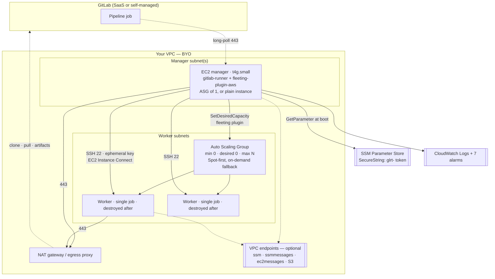
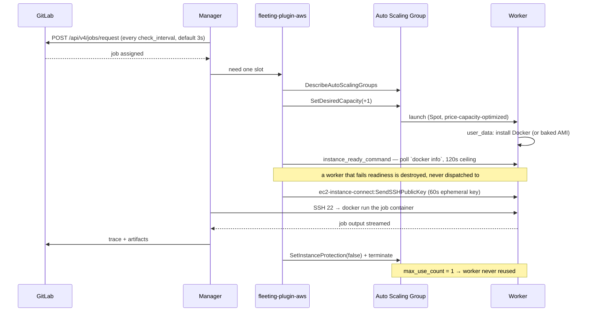
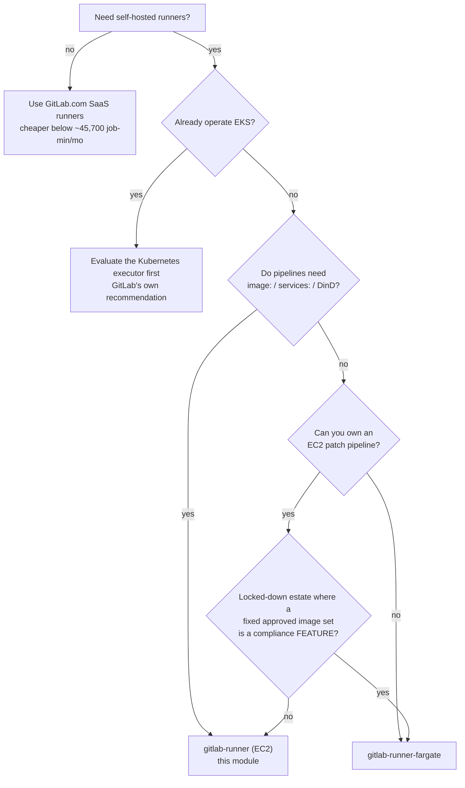

# GitLab CI/CD Runners on AWS — Architecture & Adoption Guide

**Module:** `modules/gitlab-runner`
**Status:** implemented, audited, **not yet validated against a live AWS account**
**Audience:** platform engineers choosing a CI runner topology; reviewers approving it for production; SREs who will operate it
**Companion documents:** [`README.md`](README.md) (usage), [`AUDIT.md`](AUDIT.md) (adversarial audit, 61 findings), [`COSTS.md`](COSTS.md) (cost model), [`../gitlab-runner-fargate/`](../gitlab-runner-fargate/) (the serverless alternative)

---

## 0. Expected network topology

This module is written for a **VPC with no route to the public internet**:

- **GitLab** reached over **Direct Connect or VPN** (on-prem, or a peered VPC).
- **AWS APIs** reached over **interface and gateway VPC endpoints** (PrivateLink).
- **No NAT gateway, no internet gateway, no public IPs.**

It works in an internet-connected VPC too, but that is the less-considered case.
The isolated topology is the design target because it is the one where a missing
piece of network fails as a **hang** rather than an error — see §3.6.

**The module creates no network resources at all.** Not a VPC, subnet, route
table, NAT gateway, VPC endpoint, security group, or security-group rule. It
attaches the security groups you pass it to the instances it launches, and
otherwise stays out of your network. `output.network_contract` states, as data,
exactly what your network must provide.

## 1. What this module is

A self-hosted, autoscaling GitLab CI runner fleet on AWS EC2, built on the
**GitLab Runner Autoscaler** — the `docker-autoscaler` executor driving an EC2
Auto Scaling Group through `fleeting-plugin-aws`.

One long-lived **manager** instance holds the runner registration and decides how
much capacity to hold. It drives an ASG of ephemeral **workers**, each of which
runs exactly one CI job in a Docker container and is then destroyed. The fleet
scales to zero when nothing is queued.

### What it deliberately does not do

| Out of scope | Why |
|---|---|
| VPC, subnets, routing, NAT | Belongs to a landing-zone module. |
| **Security groups and security-group rules** | **BYO.** The module attaches the SGs you give it and creates none. One rule — manager→worker SSH — is *verified* at plan time rather than created; see §3.6. |
| **VPC endpoints (PrivateLink)** | **BYO.** The module names the endpoints it needs (`output.network_contract`) and creates none. |
| Creating the GitLab runner registration | GitLab-side lifecycle. Create the runner, pass the `glrt-` token. |
| Building worker AMIs | Recommended for production, but an image pipeline is its own concern. |
| Removing the runner from GitLab on destroy | No GitLab provider dependency. See §11.4. |
| Multi-cloud | AWS only. Nothing in the design generalises cheaply. |

---

## 2. Decision summary — read this first

> ### Use this module when
> - You need **self-hosted** runners (data residency, network access to internal
>   systems, licence-bound toolchains, or compliance requiring your own compute).
> - Your pipelines rely on **`image:`**, **`services:`** (sidecar Postgres/Redis),
>   or **Docker-in-Docker**. These work here and do **not** work on the Fargate
>   sibling.
> - You have **sustained CI volume** — roughly **>45,700 job-minutes/month**, above
>   which self-hosting beats GitLab.com SaaS minutes on cost.
> - You want **Spot economics** with an **on-demand fallback**, and scale-to-zero
>   outside working hours.
>
> ### Do not use this module when
> - Your volume is low. Below ~45,700 job-minutes/month, **GitLab.com SaaS runners
>   are cheaper** and carry no operational burden. Self-hosting is a cost increase
>   at small scale, not a saving.
> - You cannot own an EC2 patch/AMI pipeline. The manager is a long-lived Linux
>   host; workers boot from an AMI. Someone must own both.
> - You need **hard multi-tenant isolation between untrusted teams on one fleet**.
>   The fleet is the trust boundary, not the project. Run one fleet per trust tier.
> - You want zero always-on cost. The manager runs 24/7 (~$15/month floor).
> - You already operate EKS and are happy there — the **Kubernetes executor** is
>   GitLab's own recommendation for that case, and this module does not implement it.

---

## 3. Architecture

### 3.1 Component view



### 3.2 Job lifecycle



### 3.3 The ASG contract — why this ASG looks wrong and is right

The worker ASG is **owned by the fleeting plugin, not by AWS autoscaling**. Every
setting below exists to stop AWS and the plugin fighting over the same fleet.

| Setting | Value | Why |
|---|---|---|
| `min_size` / `desired_capacity` | `0` / `0` | The plugin sets desired capacity. Terraform only seeds it. |
| `lifecycle.ignore_changes` | `[desired_capacity]` | Without this, every `terraform apply` would reset the live fleet to 0 and kill running jobs. |
| `protect_from_scale_in` | `true` | Upstream requirement. The plugin clears protection when retiring a worker; AWS must not scale in a machine mid-job. |
| Scaling policies | **none** | Two controllers on one fleet is a fight. The plugin is the only controller. |
| `suspended_processes` | `["AZRebalance"]` | AZRebalance terminates healthy instances to even out AZs — i.e. kills running jobs for cosmetic balance. |
| `health_check_type` | `EC2` | An ELB check is meaningless: workers serve nothing. |
| `enabled_metrics` + `metrics_granularity` | set explicitly | ASG group metrics are **opt-in**. An alarm on an unpublished metric is decoration — three of the module's alarms depend on these. |
| `instance_initiated_shutdown_behavior` | `terminate` | Stops a privileged job that runs `shutdown` from leaving a billed zombie. |

### 3.4 Manager connectivity — SSH, not SSM

The plugin reaches workers over **SSH on port 22**, authenticating with an
**ephemeral 60-second key pushed via EC2 Instance Connect**. There is no key pair
to manage or rotate.

**This is not a design choice.** SSM tunnelling is an open upstream issue in
`fleeting-plugin-aws`. Today SSH is the only path.

Consequences you must accept:
- A worker security group needs inbound 22 **from a manager security group** —
  a security-group reference, never a CIDR. The manager's SSH session carries the
  generated build script, so anything able to answer on 22 receives it.
- In an isolated VPC you need the **`ec2-instance-connect` interface endpoint**,
  or the plugin cannot push the key and no worker is ever reachable.
- The manager holds `ec2-instance-connect:SendSSHPublicKey`, double-conditioned on
  the ASG tag **and** `ec2:osuser`. That condition is the only thing preventing
  "manager compromise → root on every worker".

### 3.6 The BYO network contract — and the one rule the module verifies

Everything about the network is yours. The module asks for two things and states
the rest.

**What you pass in:**

| Input | Meaning |
|---|---|
| `manager_security_group_ids` | 1–5 SGs attached to the manager instance |
| `worker_security_group_ids` | 1–5 SGs attached to every worker |
| `manager_subnet_ids` / `worker_subnet_ids` | placement |

**What your network must provide** — emitted as data by
`output.network_contract`, because a list you can `terraform output` and hand to a
network team is more useful than a paragraph:

| Interface endpoints | Why |
|---|---|
| `ec2` | Plugin describes and tags instances |
| `autoscaling` | `SetDesiredCapacity` — **without it the fleet never scales** |
| `ec2-instance-connect` | Pushes the ephemeral SSH key — **without it no worker is reachable** |
| `ssm`, `ssmmessages`, `ec2messages` | Token retrieval and operator Session Manager access |
| `logs`, `monitoring` | Log shipping and the health heartbeat |
| **`s3` (gateway, not interface)** | Package repositories when not using a baked AMI |

Plus egress on 443 to your GitLab, your registry and your mirrors; and DNS on
UDP+TCP 53 to your resolver.

> **A missing endpoint does not error — it hangs.** With no public-internet path,
> an instance resolving a public AWS endpoint name simply waits. Nothing names the
> missing endpoint. This is why the contract is an output rather than a comment.

#### Why one rule is verified rather than left to you

`manager → worker on TCP 22` is **not network policy**. It exists because of how
this runner works — the fleeting plugin's only path to a worker — and it would be
required identically in every network topology.

Its failure mode is the worst kind: the plugin pushes a key, cannot connect, and
the job hangs until the driver's retry budget expires, **after paying for the
worker**. No error names the cause.

So the module reads your security-group rules at plan time
(`ec2:DescribeSecurityGroupRules`) and **fails the plan** if no rule permits it:

```
No rule permits TCP 22 from any manager security group to any worker security
group. The fleeting plugin reaches each worker over SSH with an ephemeral EC2
Instance Connect key; without this rule it pushes a key, cannot connect, and
every job hangs until the retry budget expires.
```

The check handles the cases that trip naive comparisons: `ip_protocol = "-1"`
(all protocols, which AWS reports with `from_port = -1`), and cross-account
references of the form `123456789012/sg-abc`.

It **cannot** resolve a rule that reaches the manager through a **prefix list**.
If that is how you grant it, set `verify_manager_to_worker_ssh_rule = false` —
an honest opt-out, because a control that fires on a correct configuration is a
control someone switches off wholesale.

Whoever runs `terraform plan` needs `ec2:DescribeSecurityGroupRules`.

### 3.5 Trust boundaries

```
┌─ GitLab (external) ────────────────────────────────────────────────┐
│  Anyone who can land a .gitlab-ci.yml can execute code on a worker │
└────────────────────────────────────────────────────────────────────┘
              │  untrusted code
              ▼
┌─ Worker (ephemeral, single-use) ───────────────────────────────────┐
│  Job container: unprivileged, no Docker socket, IMDS hop_limit 1   │
│  Worker instance role: AmazonSSMManagedInstanceCore only           │
│  Egress: 443 to internet MINUS RFC1918 · DNS to VPC resolver       │
└────────────────────────────────────────────────────────────────────┘
              │  no path back — worker cannot reach the manager
              ▼
┌─ Manager (long-lived, privileged) ─────────────────────────────────┐
│  Holds: glrt- token · ASG scaling rights · SendSSHPublicKey        │
│  No inbound rules at all. Operator access via SSM Session Manager  │
└────────────────────────────────────────────────────────────────────┘
```

The asymmetry is deliberate: **the manager can reach every worker; no worker can
reach the manager.**

---

## 4. Why this executor — decision record

GitLab Runner offers several executors. This module chose `docker-autoscaler`.
The alternatives and why they were rejected:

| Option | Verdict | Reasoning |
|---|---|---|
| **`docker-autoscaler` + fleeting-plugin-aws** | ✅ **chosen** | GA, actively developed, GitLab's supported successor to Docker Machine. Real Spot, scale-to-zero, one job per VM. `image:`/`services:`/DinD all work. |
| `docker+machine` | ❌ | Deprecated in 17.5, removal targeted GitLab 20.0 (May 2027). Building on it is building on a countdown. |
| `docker` (static host) | ❌ | No autoscaling. Jobs share one host, so workspace and cache contamination between jobs is structural. Fixed cost 24/7. |
| `shell` | ❌ | Jobs run directly on the host as the runner user. No isolation whatsoever. |
| `kubernetes` on EKS | ⚠️ **viable, not implemented** | GitLab's own recommendation if you already run EKS. Best long-term support story. Rejected here only because it makes an EKS cluster a hard dependency, which most consumers of this repo do not have. **If you already operate EKS, evaluate this first.** |
| `custom` + Fargate driver | ⚠️ **implemented separately** | See [`../gitlab-runner-fargate/`](../gitlab-runner-fargate/) and §12. Community-supported driver on a maintenance-mode executor; `image:` is ignored. Different trade-off, not a better one. |

### 4.1 Why one job per VM

`max_use_count = 1` and `capacity_per_instance = 1` are the defaults. A worker
runs one job and is destroyed.

This costs cold-start latency and buys the module's entire isolation story:

- No workspace reuse → no artifact contamination between jobs.
- No credential persistence between jobs.
- A job that compromises its worker gains a machine that is about to be destroyed.

Raising `capacity_per_instance` above 1 puts multiple concurrent jobs on one
kernel and trades that away. Do it only for a trusted, single-team fleet.

---

## 5. Trade-offs — the honest table

| Dimension | This module (EC2) | Cost of the choice |
|---|---|---|
| **CI compatibility** | ✅ `image:`, `services:`, DinD, privileged all available | You must decide whether to allow privileged; the default is off |
| **Isolation** | ✅ one job per VM, single-use, unprivileged | Cold start of 90–150s per job unless you keep a warm pool |
| **Cost at scale** | ✅ Spot + scale-to-zero | ~$15/month always-on manager floor; below ~45,700 job-min/month SaaS is cheaper |
| **Operational burden** | ⚠️ two EC2 tiers to patch | AMI pipeline, kernel CVEs, disk management are yours |
| **Supply chain** | ⚠️ boot-time package installs by default | Manager `curl \| bash`-es a repo script as root on every boot unless you bake AMIs (§9.4) |
| **Manager availability** | ⚠️ single manager | SPOF; ASG-of-1 recovers in ~2–3 min, but in-flight jobs die and workers orphan (§10.2) |
| **Worker observability** | ❌ none | A systematically broken worker bootstrap is invisible; the alarm that fires blames Spot capacity (§10.4) |
| **Scale-to-zero** | ✅ genuinely zero workers | First job after idle pays full cold start |
| **Spot interruption** | ✅ `capacity_rebalance`, 4 instance types, `price-capacity-optimized` | A reclaimed worker kills its job; needs `retry:` in `.gitlab-ci.yml` |

---

## 6. Use-case scenarios

### 6.1 ✅ Recommended — mainstream self-hosted CI

**Profile:** 20–100 engineers, 500–5,000 jobs/month, mixed toolchains, needs
`services:` for integration tests, some image building.

```hcl
module "runners" {
  source = "../../modules/gitlab-runner"

  name       = "ci"
  gitlab_url = "https://gitlab.com"
  runner_token_ssm_parameter = "/ci/gitlab/runner-token"   # not runner_token

  vpc_id            = data.aws_vpc.this.id
  worker_subnet_ids = data.aws_subnets.private.ids

  gitlab_runner_version   = "17.9.0-1"     # pinning gate refuses to build unpinned
  fleeting_plugin_version = "1.1.0"

  max_instances         = 20
  worker_instance_types = ["m6i.large", "m6a.large", "m5.large", "m5a.large"]
  spot_enabled          = true

  # Catch-all FIRST — last-match-wins. Warm during business hours.
  autoscaling_policies = [
    { idle_count = 0, idle_time = "10m0s", periods = ["* * * * *"] },
    { idle_count = 2, idle_time = "20m0s", periods = ["* 8-18 * * mon-fri"] },
  ]

  alarm_sns_topic_arns = [aws_sns_topic.ci.arn]
}
```

**Expected cost:** ~$320/month for a typical 20–30 developer team in `eu-west-1`.

### 6.2 ✅ Recommended — untrusted fork pipelines, isolated fleet

**Profile:** public repository accepting community merge requests.

Run a **separate fleet** for this. Do not share with your trusted fleet.

```hcl
name                  = "ci-untrusted"
docker_privileged     = false        # never true here
allowed_images        = ["public.ecr.aws/docker/library/node:20*"]
allowed_services      = []           # no sidecars
capacity_per_instance = 1            # one job per kernel
max_use_count         = 1            # single-use
imds_hop_limit        = 1            # container cannot reach instance role
worker_egress_cidrs   = ["203.0.113.0/24"]   # only your package mirror
```

The separate fleet is the control. GitLab protected-runner settings and the
project's fork-pipeline policy are the other half.

### 6.3 ✅ Primary design target — isolated / regulated estate, GitLab on-prem

**Profile:** banking or similar. No internet egress. GitLab over Direct Connect or
VPN. AWS APIs over PrivateLink.

This is the topology the module is written for. What you must do:

| Requirement | What it means |
|---|---|
| **Bake both AMIs** | Non-negotiable here. The default bootstrap installs packages from the internet; with no NAT it hangs. Set `worker_ami_id` and `manager_ami_id` with `gitlab-runner`, the fleeting plugin and Docker preinstalled. This also removes the boot-time supply-chain exposure entirely. |
| **Provide the endpoints** | See §3.6. `terraform output network_contract` gives your network team the list. `autoscaling` and `ec2-instance-connect` are the two whose absence is silent and total. |
| **Provide the SGs** | Egress 443 to on-prem GitLab, registry and mirrors; egress 443 to your endpoint SGs; DNS to your resolver; and inbound 22 on workers from the manager SG. |
| **Private CA** | If GitLab uses an internal CA, bake it into both AMIs. Not currently a module input. |
| **Pin the artifacts** | `gitlab_runner_version`, `fleeting_plugin_version`, and both `*_sha256` digests. The pinning gate covers versions; the digests are what cover integrity. |

```hcl
module "runners" {
  source = "../../modules/gitlab-runner"

  name       = "ci"
  gitlab_url = "https://gitlab.corp.internal"
  runner_token_ssm_parameter = "/ci/gitlab/runner-token"

  # Baked AMIs - required with no internet path.
  manager_ami_id = var.manager_ami_id
  worker_ami_id  = var.worker_ami_id

  manager_subnet_ids = var.manager_subnet_ids
  worker_subnet_ids  = var.worker_subnet_ids

  # BYO network, owned by the landing zone.
  manager_security_group_ids = [var.runner_manager_sg_id]
  worker_security_group_ids  = [var.runner_worker_sg_id]

  gitlab_runner_version      = "17.9.0-1"
  fleeting_plugin_version    = "1.1.0"
  fleeting_plugin_sha256     = var.fleeting_plugin_sha256

  alarm_sns_topic_arns = [aws_sns_topic.ci.arn]
}

output "hand_this_to_the_network_team" {
  value = module.runners.network_contract
}
```

**Compare with the Fargate sibling before committing.** It removes the AMI and
patching burden entirely, and in a locked-down estate its biggest drawback —
`image:` in `.gitlab-ci.yml` is ignored, so the image comes from the task
definition — is often a compliance *feature*: a pipeline cannot choose an
unvetted image. See §12.

### 6.4 ⚠️ Marginal — low-volume teams

Below ~45,700 job-minutes/month, GitLab.com SaaS runners cost less and carry no
operational burden. Self-hosting at this scale buys network access and data
residency, not savings. Adopt for those reasons, not for cost.

### 6.5 ❌ Not recommended — hard multi-tenancy on one fleet

The fleet is the trust boundary. One manager holds every project's job token as
it passes; one worker role is shared; one cache prefix is shared by default.

Two teams that must not be able to reach each other's secrets belong on **two
fleets**, ideally in two accounts. The module is cheap to instantiate twice —
every resource name is `var.name`-scoped and multi-fleet clean.

### 6.6 ❌ Not recommended — you cannot own EC2 patching

Two long-lived Linux tiers. If nobody owns AMI rebuilds and kernel CVEs, this
becomes a liability within months. Use the Fargate sibling or EKS.

---

## 7. Scaling & capacity model

```
concurrent (GitLab-side cap) = max_instances × capacity_per_instance
peak worker instances        = max_instances
job slots per worker         = capacity_per_instance
```

Defaults: `max_instances = 10`, `capacity_per_instance = 1` → **10 concurrent
jobs, 10 peak instances**.

### 7.1 What actually limits you

| Ceiling | Typical value | Guarded by the module? |
|---|---|---|
| EC2 On-Demand / Spot vCPU quota | account-specific | ❌ no — check before scaling |
| Subnet IP addresses | 1 ENI per worker | ❌ no |
| `ec2-instance-connect:SendSSHPublicKey` rate | notably low | ⚠️ `scale_throttle` exists but **requires Runner ≥ 17.0** |
| Manager CPU | `t4g.small` = 2 vCPU | ❌ no coupling to `concurrent` |
| SG rules per group | 60 default; the egress carve-out costs 30 | ⚠️ documented, not enforced |

### 7.2 Behaviour at 10×

Going from 10 to 100 concurrent jobs: the manager's `t4g.small` becomes the
binding constraint well before the vCPU quota does — it proxies every job trace
and holds an SSH session per worker. Move to `m7g.large` or larger and raise
`request_concurrency`.

### 7.3 Warm pool vs cold start

A cold worker costs **90–150 seconds** before the job starts: ASG launch (~25s),
`dnf install docker` over NAT (~30–60s), readiness poll, image pull.

Two mitigations, in order of effectiveness:
1. **Bake the worker AMI** with Docker and your base images preinstalled. Removes
   most of it, and removes the boot-time supply-chain exposure.
2. **`idle_count > 0`** during working hours. Costs idle Spot instances; removes
   the remainder.

---

## 8. Cost model

Full derivation in [`COSTS.md`](COSTS.md). Headline figures, `eu-west-1`:

| Scenario | Monthly | Annual |
|---|---:|---:|
| **Idle** (fleet created, zero jobs) | **~$67** | ~$800 |
| Minimal workload | ~$164 | ~$1,968 |
| **Typical** (20–30 devs, module defaults) | **~$320** | **~$3,830** |
| Heavy workload | ~$1,253 | ~$15,033 |
| Peak modelled | ~$4,174 | ~$50,090 |

### 8.1 Fixed floor — what you pay with zero jobs

| Item | Monthly |
|---|---:|
| Manager `t4g.small`, 730h | $13.43 |
| Manager 20 GB gp3 | $1.76 |
| 6 metric alarms + 1 composite | $1.10 |
| 2 custom metrics + `PutMetricData` calls | ~$1.04 |
| CloudWatch Logs (30-day) | ~tiny |
| SSM Parameter (Standard) | $0 |

The `README` claim that the fleet "costs nothing when idle" refers to **workers**.
The manager floor is ~$15/month and is unavoidable in this topology.

### 8.2 Cost levers, most to least effective

1. **Spot** (default on) — the single largest lever on worker cost.
2. **Scale-to-zero outside hours** — `idle_count = 0` catch-all (default).
3. **Bake AMIs** — cuts billed boot time on every worker.
4. **S3 gateway endpoint** — free, and cuts NAT data processing on ECR/S3 pulls.
   Note `create_vpc_endpoints` bundles it with ~$66/month of interface endpoints;
   the gateway alone is the good deal.
5. **Right-size `worker_instance_types`** — `m6i.large` is a default, not a
   recommendation for your workload.

### 8.3 Break-even vs GitLab.com SaaS

**~45,700 job-minutes/month.** Below that, SaaS minutes are cheaper than this
fleet including its manager floor and operational overhead.

---

## 9. Security model

### 9.1 Threat actors and reach

| Actor | What they get |
|---|---|
| **Developer who can edit `.gitlab-ci.yml`** | Code execution in an unprivileged container on a single-use worker. No instance credentials (`imds_hop_limit = 1`). Their own project's `CI_JOB_TOKEN`. Egress to the internet minus RFC1918. **No path to the manager.** |
| **Project maintainer (CI variables)** | The above, plus whatever `docker_volumes` / `docker_privileged` the fleet allows. |
| **Compromised worker** | Same as the developer — worker role holds only `AmazonSSMManagedInstanceCore`. Destroyed after the job. |
| **Compromised manager** | The fleet's crown: the `glrt-` token, ASG scaling rights, and `SendSSHPublicKey` to every worker. This is the asset to protect. |
| **Someone with account-wide `ec2:Describe*`** | Fleet topology, and `user_data` via `ec2:DescribeInstanceAttribute` — so anything placed in `runner_environment` or `extra_runner_config_toml` is exposed. |

### 9.2 Controls that carry the weight

| Control | What it prevents |
|---|---|
| `imds_hop_limit = 1` | Job container stealing the worker instance role |
| `docker_privileged = false` | Container escape to the worker host |
| `max_use_count = 1` | Cross-job contamination and credential persistence |
| Worker SG: inbound 22 from manager SG **only** | Anything else reaching a worker |
| Manager SG: **zero** inbound | Anything reaching the manager |
| `ec2:osuser` condition on `SendSSHPublicKey` | Manager compromise → **root** on every worker |
| RFC1918 carve-out on worker egress | Jobs reaching internal ALBs, EKS API, endpoints on 443 |
| Token via SSM SecureString | Token in Terraform state |

### 9.3 Documented security assumptions

- **The fleet is the trust boundary, not the project.** One manager sees every
  project's job token.
- **`extra_runner_config_toml` and `runner_environment` are trusted inputs.** They
  land in `user_data`, readable via `ec2:DescribeInstanceAttribute`.
- **A separate fleet per trust tier** is the module's own recommendation, stated
  twice, and is the correct answer to multi-tenancy.

### 9.4 Known weaknesses — carried forward from the audit

Stated plainly because a documented weakness is cheaper than a discovered one.

| Weakness | Impact | Mitigation |
|---|---|---|
| `package_repo_script_sha256` and `fleeting_plugin_sha256` **default empty** | Manager `curl`s a script from the internet and `bash`es it as **root on every boot**, unverified. `allow_unpinned_artifacts` gates *versions*, not *integrity*. | Set both digests, or bake AMIs (preferred). |
| Worker role carries `AmazonSSMManagedInstanceCore` | An AWS-controlled policy on the role that runs untrusted code; expandable by AWS with no diff. Also means anyone with `ssm:StartSession` can shell into a worker mid-job. | Scope `ssm:StartSession` by resource tag in account IAM. |
| No de-registration from GitLab on destroy | Token stays valid; runner list accretes offline entries. | Revoke the token GitLab-side, then destroy. |
| Worker tier has **no telemetry** | A systematically broken worker bootstrap is invisible; `capacity_shortfall` fires and blames Spot. | Bake AMIs (removes the failure mode) or add a worker-side metric. |

---

## 10. Reliability & failure modes

### 10.1 What is handled well

The manager bootstrap is defensive: `trap on_exit EXIT` publishing
`BootstrapFailure`, AWS CLI installed before the trap is armed, plugin path
resolution across four candidates, architecture verification of the plugin binary,
token via **stdin not argv**, and `config.toml` created `0600` before content lands.

Manager **infrastructure** loss is handled: stateless design plus an ASG of 1
across AZs recovers in ~2–3 minutes.

### 10.2 Manager loss — the failure that costs money

The manager is a **single point of failure**, and its loss has a second-order cost:

```
manager dies
   → in-flight jobs fail
   → workers remain, scale-in protected, with nothing to release them
   → they bill until a human intervenes
```

`max_instance_lifetime` **cannot** reclaim them: ASG-initiated replacement respects
scale-in protection, and every worker is protected.

**Detection:** the `orphaned_workers` composite alarm
(`workers_present` AND `runner_unhealthy`). Deliberately a **composite**, not
metric math — the obvious `FILL()` form resolves itself exactly when the fleet has
been orphaned longest.

**Remediation** — both steps are required:
```bash
aws autoscaling set-instance-protection --auto-scaling-group-name "$ASG" \
  --instance-ids $(...) --no-protected-from-scale-in
aws autoscaling set-desired-capacity --auto-scaling-group-name "$ASG" \
  --desired-capacity 0      # ← clearing protection alone reclaims nothing
```

### 10.3 Failure matrix

| Failure | Behaviour | Detected by |
|---|---|---|
| Manager instance loss | ASG replaces in ~2–3 min; in-flight jobs die | `manager_absent`, `runner_unhealthy` |
| Manager bootstrap failure | Instance up but unconfigured | `bootstrap_failed` |
| gitlab-runner wedged | Heartbeat stops | `runner_unhealthy` (`treat_missing_data = breaching`) |
| Spot reclaim of a worker | Job dies mid-run | GitLab-side `retry:` |
| Spot capacity exhaustion | Instances stuck pending | `capacity_shortfall` |
| Fleet pinned at ceiling | Jobs queue | `fleet_at_capacity` |
| Manager dies holding workers | Orphaned billing | `orphaned_workers` composite |
| **Worker bootstrap failure** | **Churn at 100% cost, 0% throughput** | ❌ **nothing** — see §9.4 |
| GitLab unavailable | Runner retries; no jobs picked up | ⚠️ weak — heartbeat measures the process, not job pickup |

### 10.4 The observability gap, stated honestly

`RunnerHealthy` measures whether the **process** is running. It stays green
through: a revoked token, GitLab returning 401, API throttling, and a broken
worker bootstrap.

`gitlab-runner` already exports the right signals on `:9252`
(`gitlab_runner_jobs`, `gitlab_runner_errors_total`) and the module configures that
endpoint — but nothing scrapes it. Closing this needs a CloudWatch-agent
Prometheus source. **If you run CI you care about, close it.**

---

## 11. Operational model

### 11.1 Day-2 essentials

```bash
terraform output verify_commands     # paste-ready checks
```

- Manager health: `systemctl status gitlab-runner`, or the shipped log group.
- **Region check** — the one that used to be silently fatal:
  `systemctl show gitlab-runner -p Environment` must contain `AWS_REGION`.
- Scaling errors: `aws autoscaling describe-scaling-activities` — the diagnostic
  the alarms do not name.

### 11.2 Configuration changes need a manager replacement

`manager_instance_refresh` defaults to **false**. Input changes render into
`user_data` but the running manager keeps its old config until replaced. This is
the correct default (an unpinned AMI would otherwise let an unrelated apply
replace the manager mid-job) and a real trap: a change can appear applied and be
inert for weeks.

### 11.3 Upgrading GitLab Runner

Pin `gitlab_runner_version`, change it, then replace the manager
(`manager_instance_refresh = true` for one apply, or terminate it). The pinning
gate refuses to build with an unpinned version unless
`allow_unpinned_artifacts = true`.

### 11.4 Destroy

```bash
# 1. Drain: disable the runner in GitLab, wait for in-flight jobs
# 2. Revoke the token GitLab-side — destroy does NOT do this
# 3. If workers are protected and you accept killing jobs:
#      force_delete_workers = true
# 4. terraform destroy
```

`force_delete_workers` defaults **false** — correct, because true would kill live
jobs; and it means `destroy` wedges on a non-empty protected fleet. Documented
trade, not a bug.

---

## 12. Comparison with `gitlab-runner-fargate`

Both modules exist. They are different trade-offs, not different quality levels.

| | **`gitlab-runner`** (EC2) | **`gitlab-runner-fargate`** |
|---|---|---|
| Executor | `docker-autoscaler` — **GA, actively developed** | `custom` — **maintenance mode**, community driver |
| `image:` per job | ✅ works | ❌ **ignored** — image comes from the task definition |
| `services:` (sidecars) | ✅ works | ❌ not available |
| Docker-in-Docker | ✅ available | ❌ Fargate forbids privileged |
| EC2 to patch | ⚠️ two tiers | ✅ none |
| Cold start | ~90–150s, removable with a warm pool | ~90–150s, **no warm pool possible** |
| Isolation | one job per VM | one job per **Fargate task** (kernel-level) |
| Idle floor | ~$15/mo manager | ~$18/mo manager |
| Supply chain at boot | ⚠️ `curl \| bash` as root by default | ✅ no boot-time fetch; images built ahead |
| Successor path | fleeting plugins, actively developed | ❌ none announced |

### Choosing between them



---

## 13. Known limits

- **The SSH-rule check needs `ec2:DescribeSecurityGroupRules`** at plan time, and
  cannot resolve a rule granted through a prefix list. Opt out with
  `verify_manager_to_worker_ssh_rule = false`.
- **Nothing verifies the VPC endpoints.** The module names them
  (`output.network_contract`) but cannot check they exist or that private DNS is
  on. A missing one hangs rather than errors.

- **`scale_throttle` requires Runner ≥ 17.0** while the version floor is 16.11.
  Below 17.0 it is silently ignored.
- **`worker_max_lifetime_seconds` cannot reclaim protected workers** — see §10.2.
- **The `a1` instance family** is misclassified by the architecture check.

---

## 14. Verification status

| Layer | Status |
|---|---|
| `terraform validate` / `fmt` | ✅ clean |
| `terraform test` | ✅ **109 passed** on **1.9.8 (declared floor) and current** |
| `tests/template_safety.py` | ✅ every interpolation encoded or justified |
| `tests/parse_config.py` | ✅ rendered `config.toml` + bootstrap parsed structurally |
| Offline render fixture | ✅ applies with no AWS credentials |
| **A job actually running** | ❌ **never validated against a live account** |

That last row is the important one. A green plan-level suite is fully compatible
with a broken fleet — this module's own audit found two defects that made the
fleet non-functional while 105 tests passed and seven alarms reported healthy.
**Run a real pipeline before you trust it.**

---

## 15. Appendix

### 15.1 Resource inventory

37 resources: 2 ASGs, 2 launch templates, 1 optional plain instance, 2 IAM roles +
2 instance profiles + 4 policy attachments, 3 security groups + 9 rule resources,
1 SSM SecureString, 2 VPC endpoint resources (opt-in), 1 log group, 6 metric
alarms + 1 composite alarm.

**Interface:** 71 input variables, 13 outputs.

### 15.2 Glossary

| Term | Meaning |
|---|---|
| **Manager** | Long-lived EC2 instance running `gitlab-runner`. Holds the registration and drives the ASG. |
| **Worker** | Ephemeral EC2 instance running one job in a Docker container, then destroyed. |
| **fleeting** | GitLab's autoscaling abstraction; `fleeting-plugin-aws` is the EC2 implementation. |
| **`glrt-` token** | Runner *authentication* token. Long-lived; revoke GitLab-side. |
| **Scale-in protection** | ASG flag stopping AWS terminating an instance. The plugin owns clearing it. |
| **`instance_ready_command`** | Readiness gate; a worker failing it is destroyed rather than dispatched to. |

### 15.3 Further reading

- [GitLab Runner Autoscaler](https://docs.gitlab.com/runner/runner_autoscale/)
- [Docker Autoscaler executor](https://docs.gitlab.com/runner/executors/docker_autoscaler/)
- [Fleeting](https://docs.gitlab.com/runner/fleet_scaling/fleeting/)
- [`fleeting-plugin-aws`](https://gitlab.com/gitlab-org/fleeting/plugins/aws)
- [EC2 Instance Connect](https://docs.aws.amazon.com/AWSEC2/latest/UserGuide/Connect-using-EC2-Instance-Connect.html)
