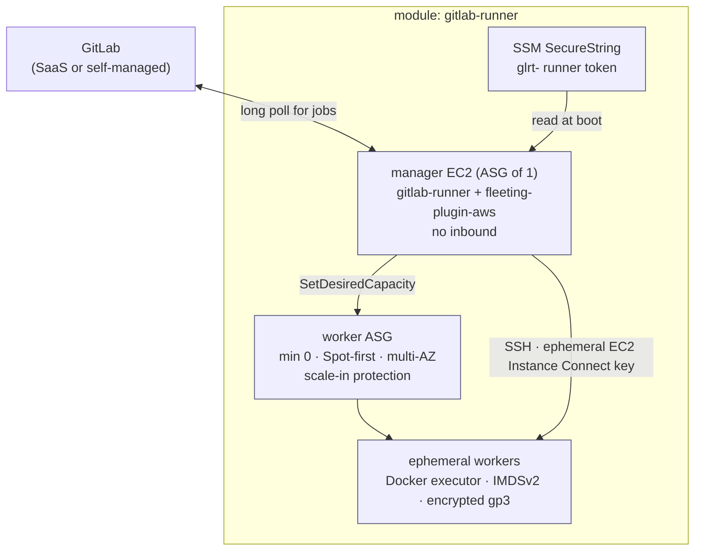

# gitlab-runner

**Autoscaling GitLab CI runners on AWS that cost nothing when idle.** A small
manager instance drives a Spot fleet of ephemeral EC2 workers via GitLab's
modern autoscaler (`docker-autoscaler` + the AWS fleeting plugin — the supported
replacement for Docker Machine), scaling from **zero** to your ceiling and back.


> **This module manages no network resources.** No VPC, subnet, route table, NAT,
> VPC endpoint, security group, or security-group rule. You pass in security
> groups; `terraform output network_contract` tells you what your network must
> provide. The expected topology is a VPC with **no public-internet route** —
> GitLab over Direct Connect/VPN, AWS APIs over PrivateLink.
>
> **Choosing a runner topology, trade-offs, use cases and cost model:**
> see [`ARCHITECTURE.md`](ARCHITECTURE.md). Adversarial audit findings:
> [`AUDIT.md`](AUDIT.md). Cost derivation: [`COSTS.md`](COSTS.md).
Secure by default: IMDSv2 enforced, encrypted volumes, no static SSH keys, no
inbound access to workers except from the manager, and the runner token held in
SSM as a SecureString — never in user_data or a launch template.

---

## Contents

- [Architecture](#architecture)
- [Quick start](#quick-start)
- [How the cost model works](#how-the-cost-model-works)
- [Recipes](#recipes)
- [Requirements](#requirements) · [Inputs](#inputs) · [Outputs](#outputs)
- [Operating it](#operating-it)
- [Testing](#testing)
- [Design notes & limits](#design-notes--limits)

---

## Architecture



The manager owns scaling — that's why the ASG has **no scaling policies** of its
own, starts at `desired_capacity = 0`, keeps `protect_from_scale_in = true`, and
has `AZRebalance` suspended. Terraform seeds it and then
`ignore_changes = [desired_capacity]` stays out of the way.

## Quick start

Create the runner in GitLab first (**Settings → CI/CD → Runners → New runner**) —
registration tokens are deprecated; you want the `glrt-…` *authentication* token.

```hcl
module "runners" {
  source = "path/to/modules/gitlab-runner"

  name              = "ci"
  # BYO network: the module attaches these and creates no network resources.
  manager_security_group_ids = [aws_security_group.manager.id]
  worker_security_group_ids  = [aws_security_group.worker.id]
  worker_subnet_ids = var.private_subnet_ids   # 3 AZs ideally

  # Prefer this: the token stays out of Terraform state entirely.
  runner_token_ssm_parameter = "/ci/gitlab-runner/token"

  # Pin what the manager fetches and runs as root (or set allow_unpinned_artifacts).
  gitlab_runner_version   = "17.9.0-1"
  fleeting_plugin_version = "1.1.0"

  max_instances = 10                           # your spend ceiling
}
```

That gets you: Spot workers across 4 instance types, one warm worker during
weekday working hours, **scale to zero** otherwise, single-use unprivileged
workers, and a self-healing manager with alarms.

Worked examples: [`examples/simple`](examples/simple/main.tf) (minimal),
[`gitlab-runner-dev`](../../examples/gitlab-runner-dev) and
[`gitlab-runner-production`](../../examples/gitlab-runner-production) — the diff
between the last two is the production checklist.

## How the cost model works

Four dials, in order of impact:

| Dial | Effect |
|---|---|
| `autoscaling_policies` with `idle_count = 0` | **Scale to zero.** No queued jobs → no instances → no compute bill. The single biggest lever. |
| `spot_enabled` (default `true`) + `spot_allocation_strategy` | Spot at `price-capacity-optimized` — cheapest among the *deepest* pools, which is what AWS recommends over `lowest-price`. |
| `worker_instance_types` (4+ across families) | More pools = fewer Spot interruptions. Diversification beats every other reliability knob. |
| `max_instances` × `capacity_per_instance` | The hard ceiling. Surfaced as the `max_concurrent_jobs` output so the number that caps your spend is explicit. |

Then: `cpu_architecture = "arm64"` for Graviton, `capacity_per_instance > 1` to
pack jobs onto fewer VMs, baked AMIs to remove boot-time package installs, the
NAT gateway, and `detailed_monitoring` left off.

## Recipes

**Always-warm pool for fast pickup** (trades idle cost for zero cold-start):

```hcl
autoscaling_policies = [
  { idle_count = 3, idle_time = "30m0s", periods = ["* * * * *"] },
]
```

**Follow the sun** — warm during business hours in two regions' worth of team,
cold overnight:

```hcl
autoscaling_policies = [
  { idle_count = 0, idle_time = "5m0s",  periods = ["* * * * *"] },   # catch-all FIRST
  { idle_count = 4, idle_time = "20m0s", periods = ["* 7-19 * * mon-fri"], timezone = "Europe/London" },
]
```

**Bursty monorepo** — keep idle capacity proportional to load:

```hcl
autoscaling_policies = [
  { idle_count = 2, scale_factor = 1.5, scale_factor_limit = 20, periods = ["* * * * *"] },
]
scale_throttle = { limit = 10, burst = 20 }   # don't stampede the EC2 API
```

**Graviton fleet** (cheaper per vCPU, needs arm64-capable images):

```hcl
cpu_architecture      = "arm64"
worker_instance_types = ["m7g.large", "m6g.large", "c7g.large", "c6g.large"]
manager_instance_type = "t4g.small"
```

**Docker-in-Docker image builds** — the one reason to turn privileged on. Do it on
a dedicated fleet, not your general one:

```hcl
docker_privileged = true    # jobs get root on the worker; scope this fleet tightly
max_use_count     = 1       # never reuse a worker that ran a privileged job
```

**Give jobs AWS permissions** (the right way — on the worker role, not the manager):

```hcl
additional_worker_policy_arns = ["arn:aws:iam::aws:policy/AmazonEC2ContainerRegistryReadOnly"]
```

**Token from Vault/another pipeline** — keep the secret out of Terraform state:

```hcl
runner_token               = ""                              # don't pass it
runner_token_ssm_parameter = "/platform/shared/runner-token" # already a SecureString
```

**Baked AMI** (recommended in production — boot time *is* job latency):

```hcl
worker_ami_id = data.aws_ami.ci_worker.id   # Docker + sshd + SSM agent preinstalled
max_use_count = 20                          # amortize the boot across more jobs
```

## Requirements

| Requirement | Detail |
|---|---|
| Terraform | `>= 1.9.0` (tested on 1.9.8 and current) |
| AWS provider | `>= 5.40.0, < 6.0.0` |
| GitLab Runner | 16.11+ on the manager (for `gitlab-runner fleeting install`) |
| Network | An existing VPC with private subnets and egress (NAT or endpoints) |
| GitLab | A runner authentication token (`glrt-…`) created up front |

## Inputs

Full list in [`variables.tf`](variables.tf) — every one is documented and
`nullable = false`. The ones that matter most:

| Name | Description | Default |
|---|---|---|
| `name` | Fleet name; prefixes every resource. | — |
| `manager_security_group_ids` / `worker_security_group_ids` | **BYO.** Attached to the instances; the module creates no SGs or rules. | — |
| `worker_subnet_ids` / `manager_subnet_ids` | Placement (3 AZs recommended). | — |
| `verify_manager_to_worker_ssh_rule` | Fail the plan if no rule permits manager→worker TCP 22. Needs `ec2:DescribeSecurityGroupRules`. | `true` |
| `runner_token` / `runner_token_ssm_parameter` | The `glrt-` token, or an existing SSM param holding it. | `""` |
| `gitlab_url` | GitLab instance. | `https://gitlab.com` |
| `max_instances` | Worker ceiling — your spend guardrail. | `10` |
| `capacity_per_instance` | Concurrent jobs per worker. | `1` |
| `max_use_count` | Jobs per worker before retirement. | `1` |
| `autoscaling_policies` | Warm-pool / scale-to-zero schedule. | warm on weekdays, zero otherwise |
| `spot_enabled` · `spot_allocation_strategy` | Spot on, `price-capacity-optimized`. | `true` |
| `on_demand_base_capacity` · `on_demand_percentage_above_base` | On-demand cushion. | `0` / `0` |
| `worker_instance_types` · `cpu_architecture` | Fleet shape. | 4× m6i/m6a/m5/m5a, `x86_64` |
| `worker_ami_id` | Baked AMI (empty = AL2023 + Docker at boot). | `""` |
| `manager_self_heal` | Manager as an ASG-of-1 vs a plain instance. | `true` |
| `docker_privileged` | Privileged job containers (= root on the worker). | `false` |
| `imds_hop_limit` | `1` blocks job containers from the instance role. | `1` |
| `additional_worker_policy_arns` | How jobs get AWS access. | `[]` |
| `permissions_boundary_arn` · `kms_key_arn` | Org guardrails. | `""` |
| `allowed_images` · `allowed_services` | Restrict what images jobs may run. | `[]` (any) |
| `gitlab_runner_version` · `fleeting_plugin_version` | Pinned artifact versions (required). | `""` |
| `fleeting_plugin_sha256` | Verify the plugin binary; refuse to start on mismatch. | `""` |
| `allow_unpinned_artifacts` | Opt in to fetching "latest" as root at boot. | `false` |
| `worker_ready_command` | Wait for Docker before dispatching a job. | docker-info loop |
| `assign_public_ips` | Public IPs on instances. | `false` |
| `create_alarms` · `alarm_sns_topic_arns` · `log_retention_days` | Observability. | `true` / `[]` / `30` |
| `force_delete_workers` | Let destroy proceed without draining (see Limits). | `false` |
| `manager_instance_refresh` | Auto-replace the manager on LT change. | `false` |
| `worker_max_lifetime_seconds` | Age ceiling for **unprotected** workers (see Limits). | `604800` |
| `extra_runner_config_toml` | Raw TOML escape hatch (S3 cache, etc.). | `""` |

## Outputs

| Name | Description |
|---|---|
| `worker_asg_name` / `worker_asg_arn` | The fleet the runner scales. |
| `manager_role_arn` / `worker_role_arn` / `worker_role_name` | Both roles — attach job permissions to the worker. |
| `network_contract` | What your network must provide, as data — endpoint list, egress and ingress requirements. Hand it to whoever owns the VPC. |
| `token_ssm_parameter` | Where the manager reads the token. |
| `max_concurrent_jobs` | `max_instances × capacity_per_instance` — the spend ceiling, stated. |
| `config_toml` | The rendered config (token placeholdered) — review it in a plan diff. |
| `verify_commands` | Paste-ready AWS CLI/SSM commands to check the manager, logs, and fleet. |

## Operating it

```bash
# Is the runner online? (also visible in GitLab -> Runners)
terraform output -json verify_commands | jq -r .find_manager      # get the instance id
aws ssm start-session --target i-… --document-name AWS-StartInteractiveCommand \
  --parameters command='sudo journalctl -u gitlab-runner -n 100 --no-pager'

# Did bootstrap succeed?
… command='sudo cat /var/log/runner-bootstrap.log'

# Is the fleet scaling?
aws autoscaling describe-auto-scaling-groups --auto-scaling-group-names <name> \
  --query 'AutoScalingGroups[0].[DesiredCapacity,Instances[*].InstanceId]'
```

`config.toml` is rendered from module inputs at every boot, so **don't hand-edit
it on the manager** — change the inputs instead.

**But note:** with `manager_instance_refresh = false` (the default), changing an
input updates the launch template and *nothing else* — the running manager keeps
its old config until it is replaced. That default exists because a replacement
kills every in-flight job. Once `manager_ami_id` is pinned, set
`manager_instance_refresh = true` and changes propagate automatically; until then,
terminate the manager instance yourself to pick up a change. Same for rotating
the token: write the new value to SSM, then replace the instance.

## Observability

The fleet publishes two custom metrics under `GitLabRunner/<name>`:

| Metric | Cadence | Meaning |
|---|---|---|
| `RunnerHealthy` | every 60s (systemd timer) | `gitlab-runner` is running. **Silence means dead** — this is the primary liveness signal, because an EC2 health check only sees the hypervisor. |
| `BootstrapFailure` | once, on a failed boot | the manager came up but could not configure itself. Silence here is the healthy state. |

Six alarms are created by default (`create_alarms`):

| Alarm | Fires when | Why it's shaped that way |
|---|---|---|
| `runner-unhealthy` | no `RunnerHealthy` heartbeat for 10 min | missing data is breaching — silence means the manager is gone |
| `bootstrap-failed` | a boot published `BootstrapFailure=1` | discrete event, so missing data is *not* breaching |
| `manager-absent` | ASG has no in-service manager | `Maximum`, so an instance refresh doesn't page |
| `fleet-at-capacity` | **desired** pinned at the ceiling for 15 min | desired, not in-service: single-use workers make in-service dip constantly |
| `capacity-shortfall` | instances stuck **pending** for 15 min | the direct signal for "AWS won't give me capacity"; behaves the same on a 2- or 200-instance fleet |
| `orphaned-workers` | workers in service while no manager is healthy | the expensive failure — see the runbook below |

Both ASGs explicitly enable the group metrics those alarms read; without that
opt-in the metrics are never published and the alarms would be decoration.

Set `alarm_sns_topic_arns` or nobody is paged. Manager logs — both the bootstrap
log and the `gitlab-runner` journal — ship to CloudWatch Logs when
`log_retention_days > 0`, and the agent is installed *first* so a failed boot
still ships the log that explains it.

## Design notes & limits

- **Workers accept SSH from the manager's security group only.** The AWS fleeting
  plugin runs jobs over SSH using a **60-second key pushed via EC2 Instance
  Connect** — so there's no keypair to manage or rotate, but port 22 must be
  reachable from the manager. Native SSM tunnelling is still an upstream feature
  request. The module verifies the rule exists rather than creating it - see
  ARCHITECTURE.md §3.6.
  `AmazonSSMManagedInstanceCore` is attached regardless, so operators get keyless
  Session Manager access today.
- **The manager is intentionally stateless.** The token lives in SSM and
  `config.toml` is regenerated at boot, which is what makes `manager_self_heal`
  (ASG-of-1) a safe default — AWS can replace the instance and CI resumes.
- **`privileged` is OFF by default, and turning it on is a real decision.** A
  privileged container is a one-line escape to root on the worker VM. Once a job
  is on the host, IMDS hop-limit-1 no longer helps (that only stops a *container*
  reaching metadata) - the job has the worker's instance role and its network
  position. What genuinely contains it is that the worker role is empty by
  default and the worker is destroyed after the job. If you build images, prefer
  a separate, tagged, GitLab-protected fleet for those jobs, or a rootless
  builder (BuildKit/Buildah).
- **Anything you attach via `additional_worker_policy_arns` IS the blast radius**
  of a malicious or compromised job. That list is the most security-relevant
  input in the module.
- **Spot interruptions will happen.** Mark jobs `interruptible: true` and set
  `retry` in `.gitlab-ci.yml`; with `capacity_per_instance = 1` a reclaim costs
  you exactly one job.
- **Boot time is job latency.** The default AMI installs Docker at boot; bake an
  AMI for production and raise `max_use_count`.
- **BYO network by design** — no VPC, subnets, or NAT here; that belongs to a
  landing-zone module.
- **Out of scope:** Fargate and Kubernetes executors, Windows/macOS runners,
  distributed S3 caching, and creating the GitLab runner registration itself
  (pass the token, or mint it with the GitLab provider at the call site).

## Security assumptions this module makes

Stated plainly, because an unstated assumption is a vulnerability:

1. **The subnets you pass are private.** The module sets `associate_public_ip_address
   = false`, but it cannot stop a subnet with `map_public_ip_on_launch` from doing
   its own thing at the route-table level. Verify your routing.
2. **Whoever can push to a project this runner serves can run arbitrary code on a
   worker.** That's what CI is. The controls are the empty worker role, the
   single-use worker, and unprivileged containers — not the container boundary.
3. **The state backend is encrypted and access-controlled**, and (unless you use
   the SSM path) contains the runner token.
4. **Fork/MR pipelines**: if the GitLab project allows pipelines from forks on this
   runner, untrusted code runs here. Gate that in GitLab.
5. **Bootstrap trusts the package repo you point at.** Pin versions, supply a
   checksum, or better: bake an AMI and set `worker_ami_id` / `manager_ami_id`.

## Production checklist

Two worked examples show both ends of the spectrum, and the diff between them is
the checklist: [`examples/gitlab-runner-production`](../../examples/gitlab-runner-production)
and [`examples/gitlab-runner-dev`](../../examples/gitlab-runner-dev).

- [ ] Token in SSM (`runner_token_ssm_parameter`), not a variable
- [ ] `gitlab_runner_version` + `fleeting_plugin_version` pinned, `fleeting_plugin_sha256` set
- [ ] Baked `worker_ami_id` + `manager_ami_id` (fast cold starts, stationary plans)
- [ ] `docker_privileged = false` (or a separate fleet for image builds)
- [ ] `permissions_boundary_arn` and a CMK (`kms_key_arn`) set
- [ ] `alarm_sns_topic_arns` wired to something that pages
- [ ] `max_instances` sized deliberately — it's the spend ceiling
- [ ] Worker egress narrowed (the default already excludes RFC1918)
- [ ] A distributed cache configured via `extra_runner_config_toml`
- [ ] Runner tags / protected flag set **in GitLab** (they're GitLab-side properties)

## Testing

Three layers, because each catches what the others cannot:

1. **`terraform test`** — 72 mocked plan runs: fleet topology, scale-to-zero ASG
   shape, Spot/on-demand models, rendered config content, IMDSv2 + encryption, SG
   scoping, DNS/NTP egress, the alarm and ASG-metric wiring, token-source
   exclusivity, the pinning gate, and a large validation-failure set.
2. **`tests/render` + `tests/parse_config.py`** — renders `config.toml` and the
   bootstrap script offline (`create = false`, no AWS credentials) and **parses**
   them. This exists because a substring assertion cannot tell
   `instance_ready_command` under `[runners.autoscaler]` from the same key under
   `[runners.autoscaler.plugin_config]` — TOML binds a bare key to whichever table
   was opened last, and getting that wrong silently disables the readiness gate.
   The rendered script is also shellchecked.
3. **A gated integration apply** (`RUN_RUNNER_INTEGRATION`) — applies
   `examples/simple`, waits for the `RunnerHealthy` heartbeat, scales the fleet to
   one worker, then destroys. Launch-template conflicts, alarms on unpublished
   metrics, and bootstrap failures are all invisible to a plan; this is the layer
   that catches them.

Run the offline pair locally:

```bash
terraform test                                   # 72 mocked runs
cd tests/render && terraform init -backend=false && terraform apply -auto-approve
terraform output -raw config_toml       > /tmp/c.toml
terraform output -raw manager_user_data > /tmp/u.sh
python3 ../parse_config.py /tmp/c.toml /tmp/u.sh
```

## Runbook: orphaned workers

The `orphaned-workers` alarm means the manager died while workers were running.
Those workers are **scale-in protected** with nothing left to release them, so
they run and bill until someone intervenes — and `worker_max_lifetime_seconds`
cannot reclaim them, because ASG-initiated replacement respects scale-in
protection. This is the one failure mode that costs real money if ignored.

```bash
ASG=$(terraform output -raw worker_asg_name)

# 1. Confirm there's no live manager (RunnerHealthy should be absent/0)
aws cloudwatch get-metric-statistics --namespace "GitLabRunner/<name>" \
  --metric-name RunnerHealthy --dimensions Name=Fleet,Value=<name> \
  --start-time "$(date -u -d '30 minutes ago' +%Y-%m-%dT%H:%M:%SZ)" \
  --end-time "$(date -u +%Y-%m-%dT%H:%M:%SZ)" --period 300 --statistics Maximum

# 2. List the orphans
IDS=$(aws autoscaling describe-auto-scaling-groups --auto-scaling-group-names "$ASG" \
  --query 'AutoScalingGroups[0].Instances[?ProtectedFromScaleIn==`true`].InstanceId' \
  --output text)
echo "$IDS"

# 3. Release protection so the ASG can reclaim them
aws autoscaling set-instance-protection --auto-scaling-group-name "$ASG" \
  --instance-ids $IDS --no-protected-from-scale-in

# 4. The replacement manager takes over from zero; the ASG scales in on its own.
```

If the manager ASG is also unhealthy, fix that first — a new manager has no
knowledge of the previous fleet and will not adopt it.

## Limits worth knowing before you rely on them

These are stated plainly because each is a place where the obvious expectation is
wrong:

- **`worker_max_lifetime_seconds` does not reclaim orphans.** It bounds the age of
  *unprotected* instances. Protected ones — exactly the orphan case — need the
  runbook above.
- **`terraform destroy` wedges while a job is running.** A scale-in-protected
  instance blocks ASG deletion. Either drain first (step 3 above) or set
  `force_delete_workers = true` for disposable fleets.
- **Config changes don't reach a running manager** unless
  `manager_instance_refresh = true`. Pin `manager_ami_id` before enabling that,
  or an unrelated AL2023 release will replace your manager mid-pipeline.
- **A self-managed GitLab on a private address** is detected and allowed through
  worker egress automatically. Anything *else* internal your jobs need (registry,

- **`extra_runner_config_toml` must start with a table header.** A bare key would
  attach to the last table in the generated config; validation rejects it.
